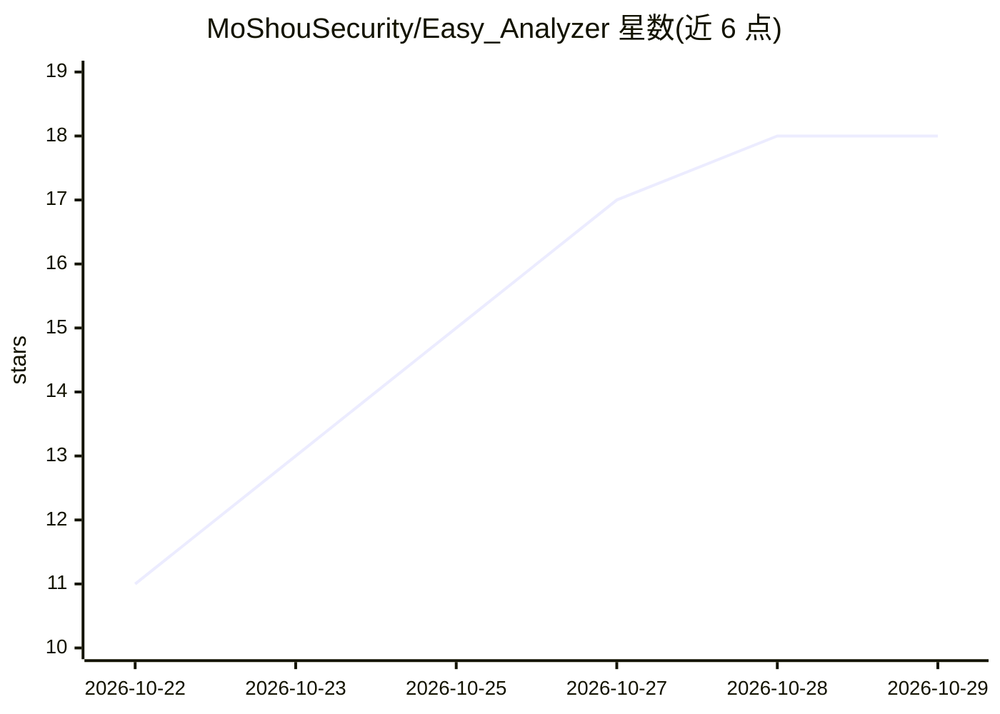

# MoShouSecurity/Easy_Analyzer

⭐ 18 · Rust · MIT · 推送 2026-10-15 · [GitHub](https://github.com/MoShouSecurity/Easy_Analyzer) · 组织维护 · 中文 README

**Rust 跨平台应急响应取证分析工具，CLI+GUI，AI 可选辅助**

用 Rust 编写的跨平台应急响应/数字取证工具，提供 CLI 与桌面 GUI（Windows x64、Linux x64、macOS ARM64）。本地解析 Windows EVTX、Linux 认证日志、Apache/Nginx 日志、进程快照与离线 PCAP，运行内置规则筛查与 IOC（IP/域名/URL）离线匹配；每次响应保存为独立 .eair 项目（内置 SQLite）持续追加证据，可导出 HTML/JSON 报告，附 Windows/Linux 各 24 条命令速查。AI 为可选功能：用户主动选择证据范围发送到配置的 OpenAI 兼容服务，不做自动脱敏。

## 筛选速览

| 维度 | 判定 | 备注 |
|---|---|---|
| AI 角色 | `ai-enhanced` | 去掉 AI 部分产品仍成立 |
| 许可风险 | `permissive` | MIT |
| 部署形态 | `desktop` | 安装包/桌面程序 |
| 模型依赖 | — | README 未给出锁定关系 |
| 硬件要求 | — | 无带数字的原话,不猜 |
| 安装摩擦 | `medium` | 含编译或系统依赖之一 |
| 成熟度 | — | 结构信号不足 |

## 能力要点

- 本地规则筛查（失败登录、账号变更、Web 攻击请求等）与 IOC 离线匹配
- .eair 独立项目文件保存证据、备注、IOC 与 AI 历史，支持多天续办
- 离线 PCAP/PCAPNG 会话汇总与基础 TLS 识别
- AI 辅助按所选范围发送到 OpenAI 兼容服务，校验证据引用

## 适用场景

- 应急响应现场导入日志、进程快照与抓包做离线线索筛查
- 多天案件续办，持续追加证据并保留分析过程
- 按 IOC 清单离线扫描并跳转证据原文

## 场景标签

`网络安全` · 领域:学习与行业

## 证据(README 行号)

> L7: Easy Analyzer 是使用 Rust 开发的跨平台应急响应分析工具，提供命令行 CLI 和桌面 GUI。支持 Windows x64、Linux x64、macOS ARM64，适合离线证据分析、现场排查和多天续办的应急响应
> L9: 默认在本地完成解析、规则筛查与 IOC 匹配。需要 AI 辅助时，由用户选择证据范围并主动发送到配置的 OpenAI 兼容服务。

## 星数曲线

2026-10-22 11 → 2026-10-29 18（+7）

---
*卡片 v1 · prompt 1.4 · 生成 2026-10-29 · 置信度 high · 依据 README sha `4c38e85e0e47` · [字段定义](../../DATASET.md)*
