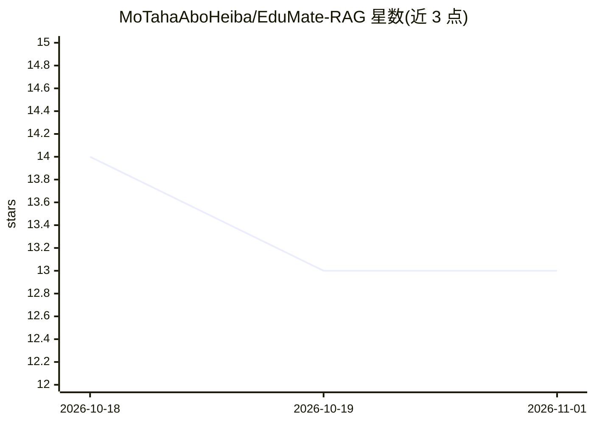

# MoTahaAboHeiba/EduMate-RAG

⭐ 13 · Python · 推送 2026-09-06 · [GitHub](https://github.com/MoTahaAboHeiba/EduMate-RAG) · [官网](https://mo-taha-aboheiba-edumate-rag.hf.space) · 个人维护

**面向大学课程教材的 RAG 问答微服务，回答带来源归属**

基于 FastAPI 的检索增强生成（RAG）服务，为 EduMate 应用提供 AI 问答层：对课程 PDF 做增量索引到 ChromaDB（本地）或 Qdrant Cloud，用 ONNX 本地嵌入（all-MiniLM-L6-v2）做语义检索，经 Groq 托管的 Llama 系列模型生成带来源文档归属的回答，支持阿拉伯语/英语多轮对话。两种运行模式：集成模式下由 .NET 后端持有用户与会话并调用本服务；独立模式下通过 X-Session-Token 管理会话。README 声明尚无认证与限流，生产部署前需自行添加。

## 筛选速览

| 维度 | 判定 | 备注 |
|---|---|---|
| AI 角色 | `ai-native` | 本体是模型或模型工具 |
| 许可风险 | `permissive` | — |
| 部署形态 | `None` |  |
| 模型依赖 | locked-api |  |
| 硬件要求 | — | 无带数字的原话,不猜 |
| 安装摩擦 | `low` | 无编译、无系统依赖或容器化 |
| 成熟度 | — | 结构信号不足 |

## 能力要点

- PDF 增量索引：文件变更检测、嵌入缓存、并行处理
- 每条回答附来源文档名的溯源机制
- 双模式：.NET 后端集成的 /api/integrations/query 与独立会话 /api/query
- 离线评测：73 组问答对上 Precision@5≈0.73、Recall@10≈0.86、MRR≈0.80

## 适用场景

- 给我的学习 App 加一个只基于课程教材的回答服务
- 对课程 PDF 建索引做多轮追问式答疑
- 本地或演示环境独立运行课程问答服务进行测试

## 场景标签

`RAG` `文档问答` · 领域:知识与检索

## 证据(README 行号)

> L14: **EduMate RAG** is a conversational question-answering service for university course materials. It retrieves releva
> L33: - **AI-Powered Generation**: Groq's `openai/gpt-oss-120b`

## 星数曲线

2026-10-18 14 → 2026-11-01 13（-1）

---
*卡片 v1 · prompt 1.4 · 生成 2026-10-31 · 置信度 high · 依据 README sha `08b37bdc626e` · [字段定义](../../DATASET.md)*
