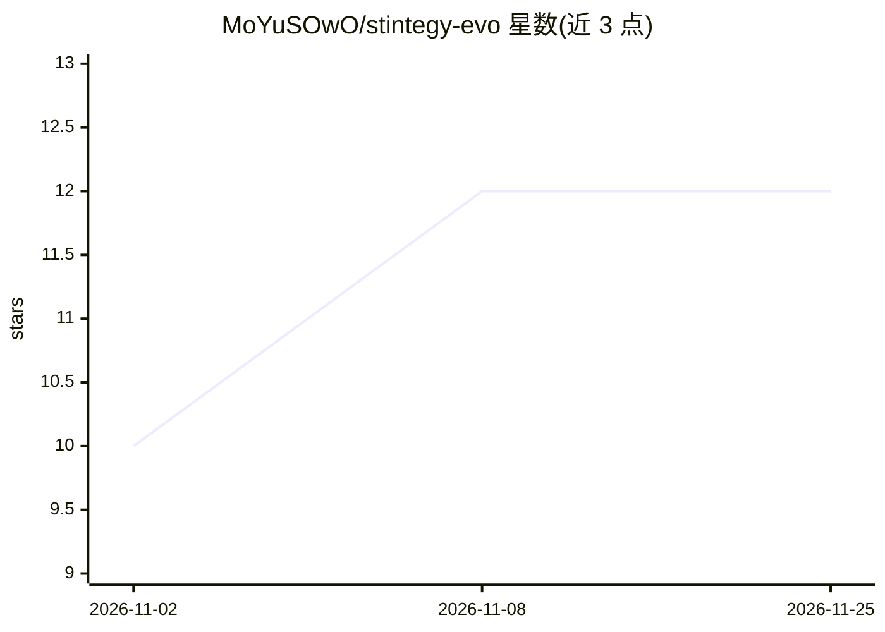

# MoYuSOwO/stintegy-evo

⭐ 12 · C# · AGPL-3.0 · 推送 2026-11-21 · [GitHub](https://github.com/MoYuSOwO/stintegy-evo) · 个人维护 · 中文 README

**为策略开发者提供的实时赛车模拟核心，AI 从外部接入**

以 C#/.NET 实现的实时赛车模拟核心：包含车辆与轮胎物理（滑移角、Pacejka 类模型）、能量与磨损、赛道几何与确定性步进，Godot 提供 3D 展示层。它只提供世界，不含任何驱动者：规则式、学习式或人类控制器统一通过 IDriverController 一个小接口从外部接入。内容全部来自 mod 机制（赛道、轮胎、底盘、车手），支持种子化可复现比赛。维护者声明由个人按自己的节奏开发，不承诺处理 issue 与 PR。

## 筛选速览

| 维度 | 判定 | 备注 |
|---|---|---|
| AI 角色 | `ai-enhanced` | 去掉 AI 部分产品仍成立 |
| 许可风险 | `viral` | AGPL-3.0 |
| 部署形态 | `None` |  |
| 模型依赖 | — | README 未给出锁定关系 |
| 硬件要求 | — | 无带数字的原话,不猜 |
| 安装摩擦 | `medium` | 含编译或系统依赖之一 |
| 成熟度 | `idea` | |

## 能力要点

- 通过单一 IDriverController 接口从外部接入任何控制器
- 车辆/轮胎物理、能量磨损、碰撞与尾流等确定性步进模拟
- mod 注册表机制管理赛道、轮胎、底盘、车手等内容
- Godot 3D 视图、HUD 与物理状态 CSV 记录

## 适用场景

- 开发并测试自己的赛车策略控制器
- 在同一物理世界下对比不同驾驶模型
- 基于官方 mod 数据复现可种子化的比赛

## 场景标签

 · 领域:赛车模拟/游戏工具

## 证据(README 行号)

> L7: StintegyEVO is a real-time racing simulation: vehicle and tyre physics, energy and wear, tracks, race stepping, and 
> L54: What is **not** here: rule-based or learned drivers, racing-line solvers, observation vectors, neural networks, tra

## 星数曲线

2026-11-02 10 → 2026-11-25 12（+2）

---
*卡片 v1 · prompt 1.4 · 生成 2026-11-18 · 置信度 high · 依据 README sha `db31b1452481` · [字段定义](../../DATASET.md)*
