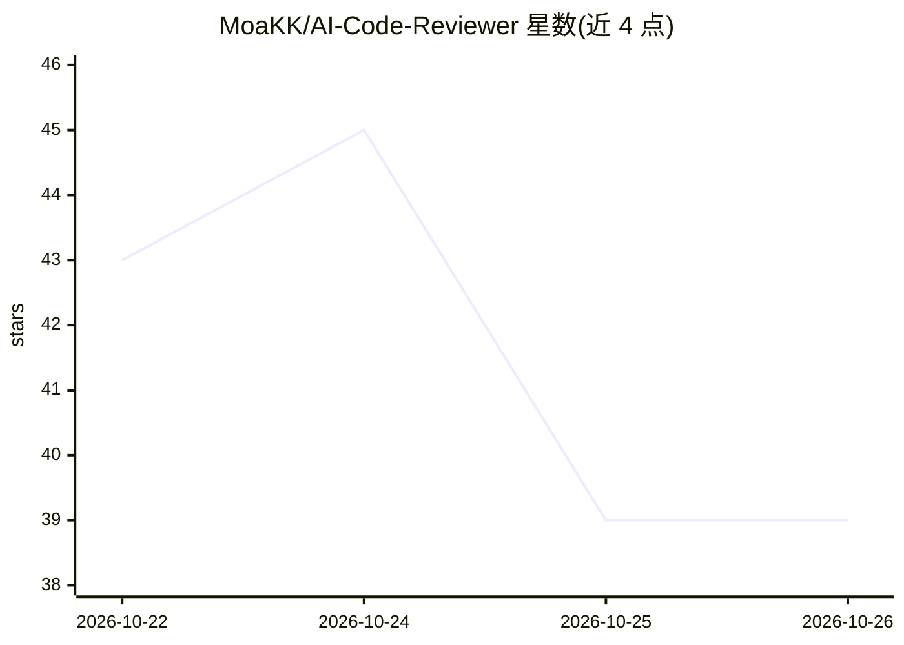

# MoaKK/AI-Code-Reviewer

⭐ 39 · TypeScript · 推送 2026-05-04 · [GitHub](https://github.com/MoaKK/AI-Code-Reviewer) · 个人维护

**用 Claude API 自动审查 PR 的 GitHub Actions 机器人**

部署在目标仓库内的 GitHub Actions 工作流：PR 打开或更新时获取变更文件的 diff，逐个发送给 Claude（claude-sonnet-4-6）按可自定义的系统提示词分析，解析返回的 JSON 评论并过滤越界行号，最终以单条 GitHub review 形式发布行内评论，并附按文件统计问题数的顶层总结。重推时仅审查该次推送变更的文件，默认跳过 lock 文件与 dist/ 目录。使用者需复制工作流与 scripts/ 目录并配置 ANTHROPIC_API_KEY。

## 筛选速览

| 维度 | 判定 | 备注 |
|---|---|---|
| AI 角色 | `ai-native` | 本体是模型或模型工具 |
| 许可风险 | `none` | — |
| 部署形态 | `None` |  |
| 模型依赖 | locked-api |  |
| 硬件要求 | — | 无带数字的原话,不猜 |
| 安装摩擦 | `low` | 无编译、无系统依赖或容器化 |
| 成熟度 | — | 结构信号不足 |

## 能力要点

- PR 触发自动获取 diff 并逐文件调用 Claude 分析
- 行内评论 + 顶层总结评论两种输出形式，越界行号自动过滤
- 重推（synchronize）时用 compareCommits 只审查该次变更文件
- 模型名、审查提示词、忽略文件正则集中在 constants.ts 可自定义

## 适用场景

- 开源/团队仓库在 PR 中自动获得 AI 代码审查意见
- 按团队规范自定义审查提示词的侧重点与语气
- 只想审查增量变更而非整个 PR 的场景

## 场景标签

`代码审查` · 领域:编码与开发

## 证据(README 行号)

> L3: A GitHub Actions bot that automatically reviews pull requests using the Claude API. When a PR is opened or updated, 
> L64: 2. `reviewFile()` — send each file to Claude
> L81: 1. Sends the file path and its diff patch to `claude-sonnet-4-6` with the review instructions as a cached system pr

## 星数曲线

2026-10-22 43 → 2026-10-26 39（-4）

---
*卡片 v1 · prompt 1.4 · 生成 2026-10-25 · 置信度 high · 依据 README sha `01ebf57b0b84` · [字段定义](../../DATASET.md)*
