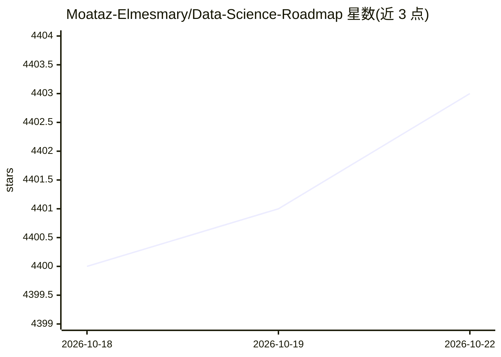

# Moataz-Elmesmary/Data-Science-Roadmap

⭐ 4,403 · MIT · 推送 2025-12-06 · [GitHub](https://github.com/Moataz-Elmesmary/Data-Science-Roadmap) · [官网](https://www.linkedin.com/posts/moatazelmesmary_github-moataz-elmesmarydata-science-roadmap-activity-6974293994960769024-yCdi?utm_source=share&utm_medium=member_desktop) · 个人维护

**数据科学自学路线图：分阶段免费学习资源清单**

面向想进入数据科学领域的学习者的自学路线图仓库：先辨析 Data Science / Data Analytics / Data Engineering 三个方向的区别，再按 Beginner（统计、概率、Python/R、Pandas、SQL、可视化、数据仓库等）、Intermediate、Advanced 三阶段组织免费课程、书籍、视频与练习资源，含大量阿拉伯语课程链接。形态为纯资源清单（含视频、文章、书籍、项目建议），无可安装代码。

## 筛选速览

| 维度 | 判定 | 备注 |
|---|---|---|
| AI 角色 | `ai-knowledge` | 知识聚合/清单类 |
| 许可风险 | `permissive` | MIT |
| 部署形态 | `None` |  |
| 模型依赖 | — | README 未给出锁定关系 |
| 硬件要求 | — | 无带数字的原话,不猜 |
| 安装摩擦 | `low` | 无编译、无系统依赖或容器化 |
| 成熟度 | — | 结构信号不足 |

## 能力要点

- 三阶段（初级/中级/高级）学习路径组织
- 覆盖统计、编程、Pandas/NumPy、SQL、数据仓库、ML 数学等主题
- 辨析数据科学/数据分析/数据工程三方向职责与工具差异
- 提供 IDE 选择建议（Anaconda、Colab、PyCharm 等）

## 适用场景

- 按阶段系统地自学数据科学并找免费课程
- 区分数据科学、数据分析、数据工程的职业方向
- 寻找 SQL、数据可视化、数据仓库等专项免费资源

## 场景标签

`精选清单` `教程课程` · 领域:学习与行业

## 证据(README 行号)

> L3: ### Data Science Roadmap for anyone interested in how to break into the field!
> L5:  This repository is intended to provide a free Self-Learning Roadmap to learn the field of Data Science. I provide s

## 星数曲线

2026-10-18 4,400 → 2026-10-22 4,403（+3）

---
*卡片 v1 · prompt 1.4 · 生成 2026-10-20 · 置信度 high · 依据 README sha `a1c0615dd61a` · [字段定义](../../DATASET.md)*
