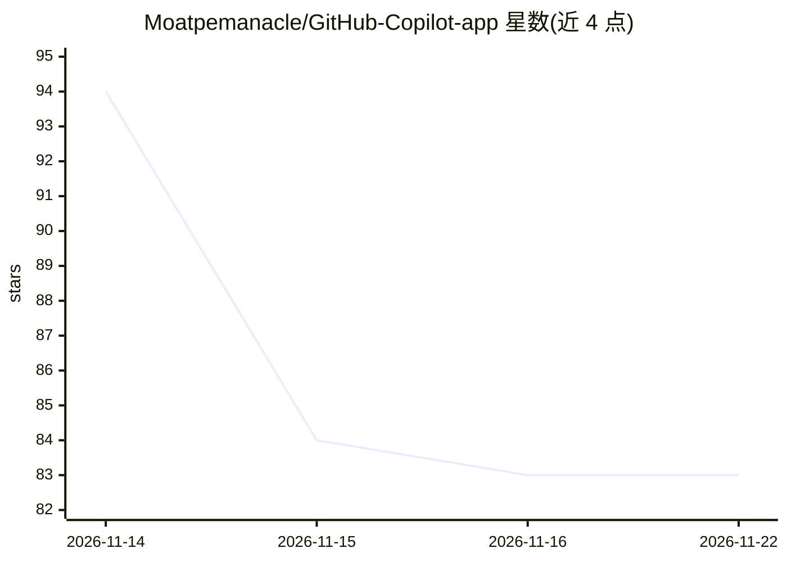

# Moatpemanacle/GitHub-Copilot-app

⭐ 83 · Apache-2.0 · 推送 2026-11-15 · [GitHub](https://github.com/Moatpemanacle/GitHub-Copilot-app) · 个人维护

**管理 GitHub 仓库软件开发工作的 agent 桌面客户端**

面向开发者的桌面应用：查找待办工作、启动与引导 agent 会话、审查进度并落地变更。本地会话各自运行在隔离的 git worktree 中，云端会话运行于 GitHub 托管的隔离环境；Canvases 将计划、终端、diff 等呈现为可检查界面；另有 My Work 聚合视图、Automations 定时任务与 Agent Merge 协助走完 PR 审查合并流程。前置要求为 Git 与任一 GitHub Copilot 订阅（或自带 key 接入自有模型提供商）。注意：仓库账号为个人，下载链接指向 Dropbox 的 rar 压缩包，非 GitHub 官方分发渠道。

## 筛选速览

| 维度 | 判定 | 备注 |
|---|---|---|
| AI 角色 | `ai-ecosystem` | LLM/agent 周边工具 |
| 许可风险 | `permissive` | Apache-2.0 |
| 部署形态 | `desktop` | 安装包/桌面程序 |
| 模型依赖 | — | README 未给出锁定关系 |
| 硬件要求 | — | 无带数字的原话,不猜 |
| 安装摩擦 | `low` | 无编译、无系统依赖或容器化 |
| 成熟度 | — | 结构信号不足 |

## 能力要点

- 本地会话运行于隔离 git worktree，云端会话运行于 GitHub 托管隔离环境
- Canvases 将 agent 的计划、终端、diff 呈现为可编辑与验证的界面
- My Work 聚合会话、issue、PR 与仓库上下文
- Automations 支持定时/后台任务，Agent Merge 协助 PR 审查与合并

## 适用场景

- 跨多个 GitHub 仓库并行运行和管理 agent 开发任务
- 在一个桌面端界面内跟踪 issue、PR 与 agent 会话进展
- 把重复性提示和工作流配置为定时后台任务

## 场景标签

`编码 Agent` · 领域:编码与开发

## 证据(README 行号)

> L3: The GitHub Copilot app is an agent-native desktop experience for finding, running, steering, and landing software wo
> L13: The GitHub Copilot app is an agent-native desktop experience for managing software work from idea to pull request. 
> L26: - A GitHub Copilot plan — any plan works, including Copilot Free and GitHub Copilot Student. No Copilot plan? You c

## 星数曲线

2026-11-14 94 → 2026-11-22 83（-11）

---
*卡片 v1 · prompt 1.4 · 生成 2026-11-18 · 置信度 mid · 依据 README sha `09ad0f55fd86` · [字段定义](../../DATASET.md)*
