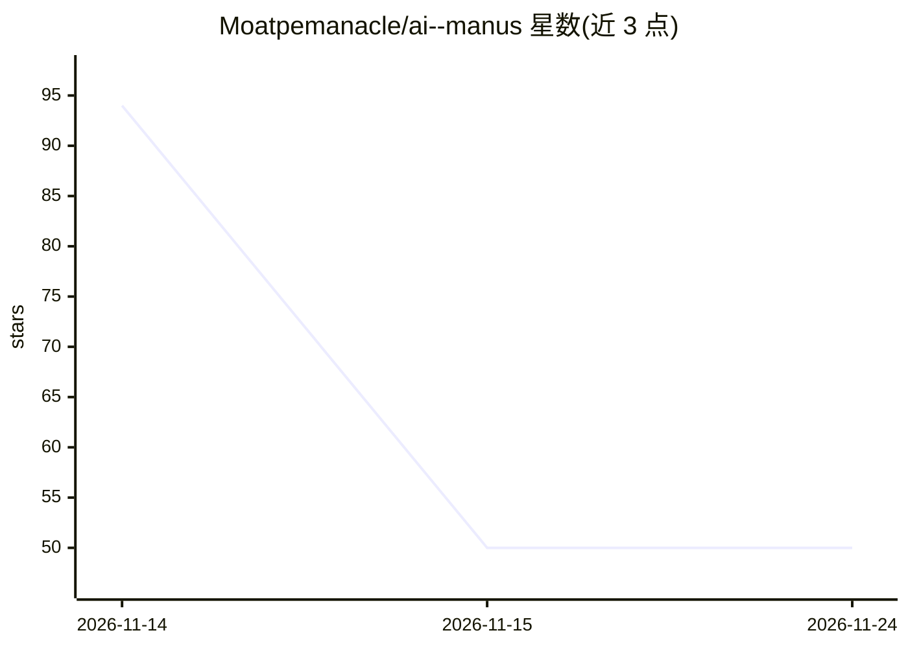

# Moatpemanacle/ai--manus

⭐ 50 · Apache-2.0 · 推送 2026-11-15 · [GitHub](https://github.com/Moatpemanacle/ai--manus) · 个人维护

**面向日常任务的自主 AI Agent：代用户运行代码与操作浏览器**

Manus 是一个自主 AI Agent，按用户指令编写并执行脚本、打开网页、填写表单、完成多步骤任务，定位为家庭、学习与轻量办公场景的个人助手，而非企业平台。README 说明其代码执行与浏览器控制可在同一流程内衔接，并跨会话保持任务模式。但 README 为功能描述文案，未给出任何安装命令、技术架构、模型接入方式或源码说明；兼容性表列出最低双核 CPU、4GB 内存等运行条件。'Download Manus' 与促销码 'PROMO2026' 出现在开头，具体获取渠道未说明。

## 筛选速览

| 维度 | 判定 | 备注 |
|---|---|---|
| AI 角色 | `ai-native` | 本体是模型或模型工具 |
| 许可风险 | `permissive` | Apache-2.0 |
| 部署形态 | `None` |  |
| 模型依赖 | — | README 未给出锁定关系 |
| 硬件要求 | — | 无带数字的原话,不猜 |
| 安装摩擦 | `low` | 无编译、无系统依赖或容器化 |
| 成熟度 | — | 结构信号不足 |

## 能力要点

- 自主执行代码与控制浏览器（导航、填表、采集信息）
- 代码与浏览器动作可在同一多步任务流程中衔接
- 面向家庭/学习/轻办公的小规模任务自动化
- 兼容性表给出最低与推荐硬件配置

## 适用场景

- 让 agent 代为完成重复性的网页操作与数据收集
- 学习场景下整理研究笔记、运行小脚本
- 轻量办公中跨多页面汇总信息并生成摘要

## 场景标签

`AI 助手` `浏览器自动化` · 领域:效率与自动化

## 证据(README 行号)

> L10: - **Autonomous Code Execution:** Manus AI agent runs code on its own to complete tasks, so you can focus on decisio
> L18: Manus is an autonomous AI agent designed to run code and control a browser on your behalf. Instead of acting like a
> L22: Manus is not a heavy studio suite or a complex enterprise platform. It is a focused helper built for home, study, a

## 星数曲线

2026-11-14 94 → 2026-11-24 50（-44）

---
*卡片 v1 · prompt 1.4 · 生成 2026-11-18 · 置信度 low · 依据 README sha `67d62343600d` · [字段定义](../../DATASET.md)*
