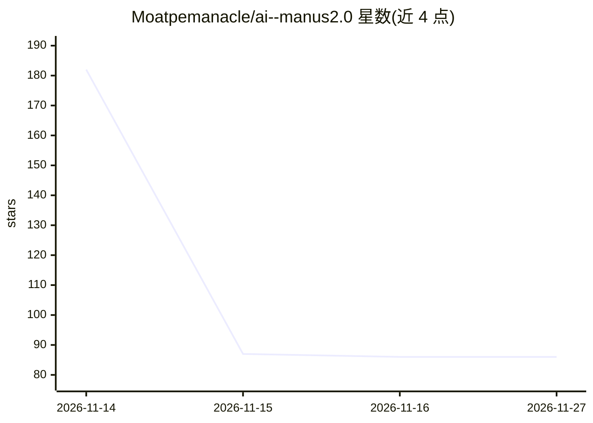

# Moatpemanacle/ai--manus2.0

⭐ 86 · Apache-2.0 · 推送 2026-11-15 · [GitHub](https://github.com/Moatpemanacle/ai--manus2.0) · 个人维护

**自主执行代码与控制浏览器的通用 AI Agent 助手**

README 描述了一个面向家庭、学习与轻量办公场景的自主 AI Agent：代替用户编写并执行脚本、控制浏览器（导航网页、填写表单、采集信息）、执行多步自动化任务，并以个人助手形式在后台常驻响应。声称支持跨会话记住工作流模式，脚本与浏览器操作可在同一流程内衔接。README 未给出具体技术实现、模型接入方式或安装命令，仅提供硬件兼容表与使用步骤说明。

## 筛选速览

| 维度 | 判定 | 备注 |
|---|---|---|
| AI 角色 | `ai-native` | 本体是模型或模型工具 |
| 许可风险 | `permissive` | Apache-2.0 |
| 部署形态 | `None` |  |
| 模型依赖 | — | README 未给出锁定关系 |
| 硬件要求 | — | 无带数字的原话,不猜 |
| 安装摩擦 | `low` | 无编译、无系统依赖或容器化 |
| 成熟度 | — | 结构信号不足 |

## 能力要点

- 自主编写并执行脚本完成任务
- 浏览器控制：导航、填表、信息采集
- 脚本与浏览器操作衔接为同一工作流
- 面向学习、家庭与轻量办公的多步任务自动化

## 适用场景

- 让 Agent 代我完成重复的网页操作与表单填写
- 学习与调研时自动收集资料、整理笔记、运行小脚本
- 日常多项目并行时把重复性小任务交给后台助手

## 场景标签

`工作流自动化` `AI 助手` `浏览器自动化` · 领域:效率与自动化

## 证据(README 行号)

> L10: - **Autonomous Code Execution:** Manus AI agent runs code on its own to complete tasks, so you can focus on decisio
> L18: Manus is an autonomous AI agent designed to run code and control a browser on your behalf. Instead of acting like a

## 星数曲线

2026-11-14 182 → 2026-11-27 86（-96）

---
*卡片 v1 · prompt 1.4 · 生成 2026-11-18 · 置信度 mid · 依据 README sha `67d62343600d` · [字段定义](../../DATASET.md)*
