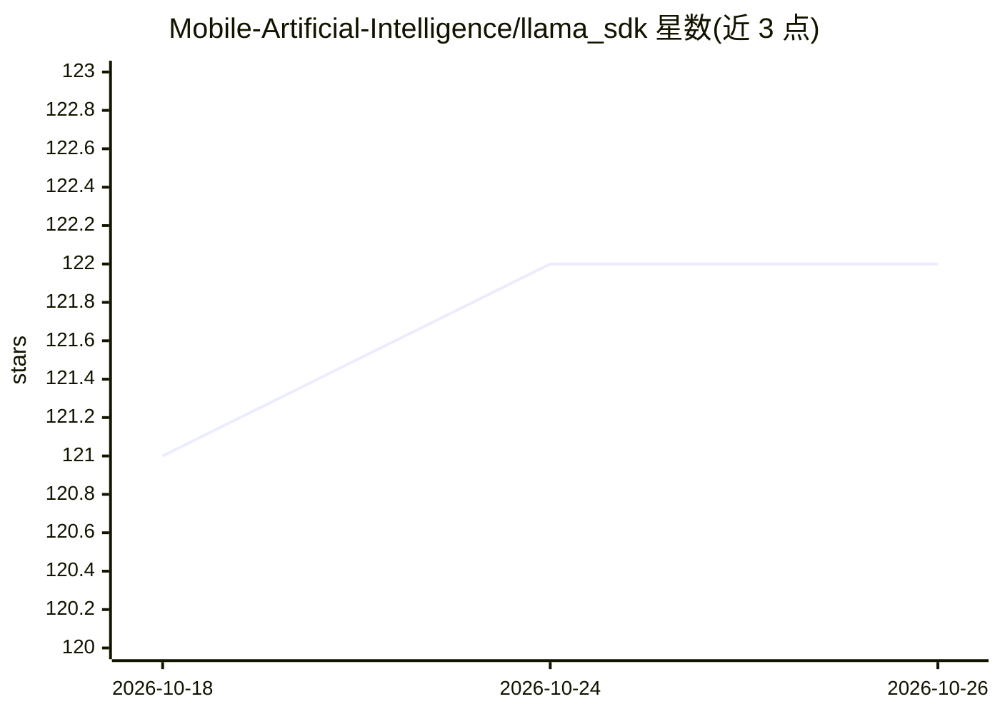

# Mobile-Artificial-Intelligence/llama_sdk

⭐ 122 · C++ · MIT · 推送 2026-10-25 · [GitHub](https://github.com/Mobile-Artificial-Intelligence/llama_sdk) · 组织维护

**llama.cpp 的 Dart 实现，供 Maid 移动端运行本地模型**

用 Dart 实现的 llama.cpp 绑定库，被移动人工智能发行版 Maid 使用。以 Flutter/Dart 包形式提供，通过 pubspec.yaml 添加依赖后导入使用；支持可选的 isolates 并行处理与流式输出，可加载 GGUF 模型文件并指定上下文长度等参数。README 列出 Android/iOS/Linux/macOS/Windows 的构建入口，采用 MIT 许可证。版本为 0.0.5。

## 筛选速览

| 维度 | 判定 | 备注 |
|---|---|---|
| AI 角色 | `ai-ecosystem` | LLM/agent 周边工具 |
| 许可风险 | `permissive` | MIT |
| 部署形态 | `None` |  |
| 模型依赖 | — | README 未给出锁定关系 |
| 硬件要求 | — | 无带数字的原话,不猜 |
| 安装摩擦 | `low` | 无编译、无系统依赖或容器化 |
| 成熟度 | — | 结构信号不足 |

## 能力要点

- llama.cpp 的 Dart 语言实现
- 支持 isolates 并行处理（可选）与流式输出
- 通过 pubspec.yaml 依赖安装的 Dart 包
- README 列出 5 个平台的构建入口

## 适用场景

- Flutter 应用中加载 GGUF 模型做本地推理
- 为 Maid 等 Dart 项目提供 llama.cpp 能力
- 跨 Android/iOS/桌面平台的本地 LLM 集成

## 场景标签

`推理引擎` · 领域:训练与推理

## 证据(README 行号)

> L11: llama_sdk is a dart implementation of llama.cpp used by the mobile artificial intelligence distribution (maid)

## 星数曲线

2026-10-18 121 → 2026-10-26 122（+1）

---
*卡片 v1 · prompt 1.4 · 生成 2026-10-23 · 置信度 high · 依据 README sha `be19c477227f` · [字段定义](../../DATASET.md)*
