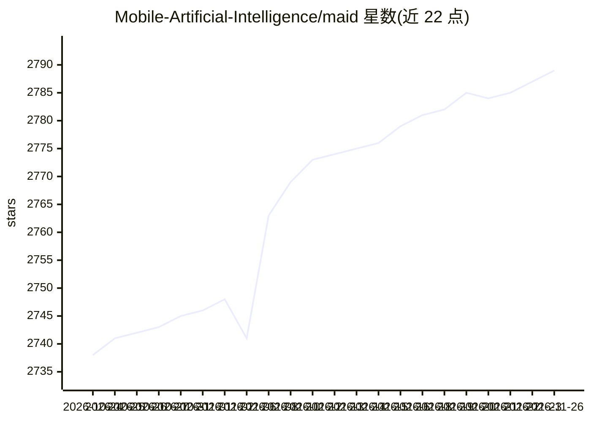

# Mobile-Artificial-Intelligence/maid

⭐ 2,789 · TypeScript · MIT · 推送 2026-10-29 · [GitHub](https://github.com/Mobile-Artificial-Intelligence/maid) · 组织维护

**Android 本地/远程 LLM 聊天客户端，支持 GGUF 离线推理**

基于 React Native 构建的 Android 应用，通过 llama.cpp 在设备端运行 GGUF 模型，无需联网；也可通过自带 API key 连接多家远程服务，或经自托管 LiteLLM 代理接入 100+ 提供商。应用内可浏览并一键下载 Hugging Face 上的精选模型，或从本地存储加载任意 GGUF 文件；支持会话管理（JSON 导入导出）、生成参数调节、自定义系统提示词，语音输出依赖配套应用 Maise。MIT 许可，无遥测与广告。

## 筛选速览

| 维度 | 判定 | 备注 |
|---|---|---|
| AI 角色 | `ai-native` | 本体是模型或模型工具 |
| 许可风险 | `permissive` | MIT |
| 部署形态 | `None` |  |
| 模型依赖 | local-ok | 支持本地模型 |
| 硬件要求 | — | 无带数字的原话,不猜 |
| 安装摩擦 | `low` | 无编译、无系统依赖或容器化 |
| 成熟度 | — | 结构信号不足 |

## 能力要点

- llama.cpp 全本地 GGUF 推理，无需联网
- 接入多家远程提供商，自托管 LiteLLM 代理可聚合 100+ 提供商
- 应用内一键下载 Hugging Face 精选模型，或加载本地任意 GGUF 文件
- 会话 JSON 导入导出与逐会话生成参数调节

## 适用场景

- 在无网络环境下于手机上离线运行本地模型对话
- 用自己的 API key 在手机上使用多家云端模型
- 从本地存储加载自己准备好的 GGUF 模型文件

## 场景标签

`聊天机器人` · 领域:对话与助手

## 证据(README 行号)

> L25: Maid is a free and open source application for interfacing with llama.cpp models locally, and with API Route, Anthr
> L31: - **Local inference** — run GGUF models fully on-device via llama.cpp; no internet required

## 星数曲线

2026-10-24 2,738 → 2026-11-26 2,789（+51）

---
*卡片 v1 · prompt 1.4 · 生成 2026-11-23 · 置信度 high · 依据 README sha `1c8274c971b1` · [字段定义](../../DATASET.md)*
