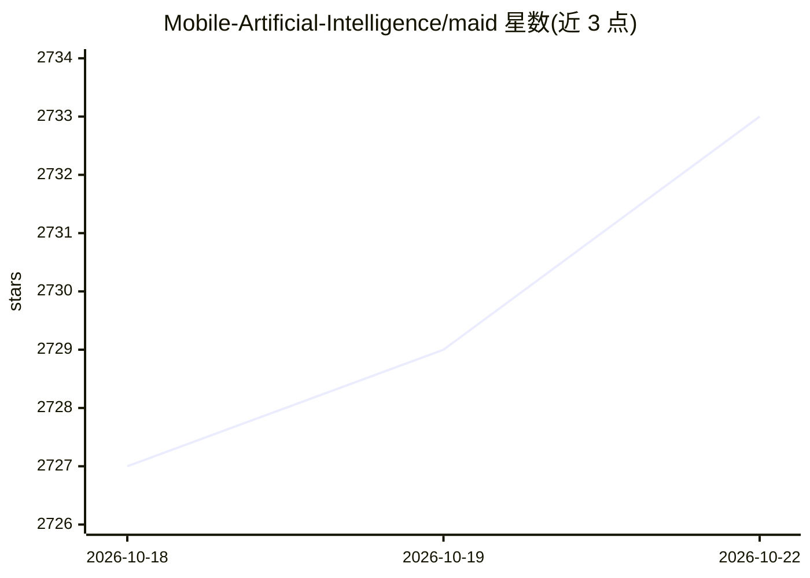

# Mobile-Artificial-Intelligence/maid

⭐ 2,734 · TypeScript · MIT · 推送 2026-10-15 · [GitHub](https://github.com/Mobile-Artificial-Intelligence/maid) · 组织维护

**Android 本地/远程 LLM 聊天客户端，支持 llama.cpp 端侧推理**

基于 React Native 的 Android 应用，供用户与本地及远程大模型对话：通过 llama.cpp 在设备端运行 GGUF 模型（无需联网），或用自有 API key 接入 Anthropic、DeepSeek、Ollama、OpenAI、Mistral 等远程服务，亦可连接自托管 LiteLLM 代理聚合 100+ 供应商。内置应用内一键下载 Hugging Face 精选模型、加载本地 GGUF 文件、会话管理、生成参数调节与系统提示词设置。语音输出依赖配套应用 Maise。MIT 许可，无遥测无广告；通过 GitHub Releases 与 Google Play 分发。

## 筛选速览

| 维度 | 判定 | 备注 |
|---|---|---|
| AI 角色 | `ai-ecosystem` | LLM/agent 周边工具 |
| 许可风险 | `permissive` | MIT |
| 部署形态 | `None` |  |
| 模型依赖 | local-ok | 支持本地模型 |
| 硬件要求 | — | 无带数字的原话,不猜 |
| 安装摩擦 | `low` | 无编译、无系统依赖或容器化 |
| 成熟度 | — | 结构信号不足 |

## 能力要点

- 通过 llama.cpp 在设备端离线运行 GGUF 模型
- 接入 12 种远程供应商（Anthropic/DeepSeek/Ollama/OpenAI 等），支持自托管 LiteLLM 代理
- 应用内一键下载 Hugging Face 精选模型（Qwen/Phi/LFM/TinyLlama 等）
- 会话导入导出 JSON、逐会话调节温度/top-p/top-k/上下文长度等参数

## 适用场景

- 在 Android 手机上离线运行本地 GGUF 模型对话
- 用一个应用管理多个远程 LLM 供应商的 API 调用
- 随时调节生成参数并与自定义助手人设对话

## 场景标签

`聊天机器人` · 领域:对话与助手

## 证据(README 行号)

> L25: Maid is a free and open source application for interfacing with llama.cpp models locally, and with API Route, Anthr
> L31: - **Local inference** — run GGUF models fully on-device via llama.cpp; no internet required
> L32: - **Remote providers** — connect to API Route, Anthropic, DaoXE, DeepSeek, Mistral, Novita, Ollama, llmman, Opper, 

## 星数曲线

2026-10-18 2,727 → 2026-10-22 2,733（+6）

---
*卡片 v1 · prompt 1.4 · 生成 2026-10-21 · 置信度 high · 依据 README sha `441e5debd02c` · [字段定义](../../DATASET.md)*
