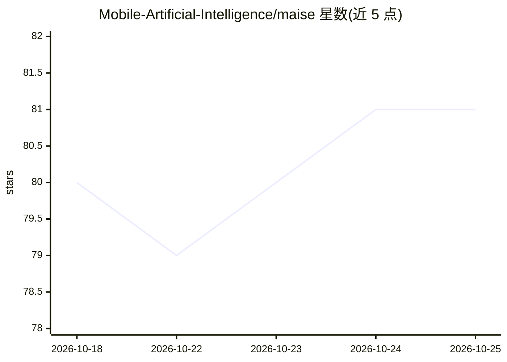

# Mobile-Artificial-Intelligence/maise

⭐ 81 · Kotlin · MIT · 推送 2026-09-03 · [GitHub](https://github.com/Mobile-Artificial-Intelligence/maise) · 组织维护

**Android 端侧语音引擎：系统级 TTS 与离线 ASR**

开源 Android 语音引擎，包含两部分：TTS 以 Android 系统 TTS 服务形式提供，任何使用标准 TextToSpeech API 的应用可直接调用；ASR 以 RecognitionService 形式提供，兼容标准 SpeechRecognizer API。全部处理在设备端通过 ONNX Runtime 完成：TTS 管线为文本规范化、Open Phonemizer 音素化、Kokoro 多语言神经模型合成、流式播放；ASR 使用 distil-whisper/distil-small.en 进行转写。内置 11 种语言的 Kokoro 语音，需从源码用 Gradle 构建生成 APK。

## 筛选速览

| 维度 | 判定 | 备注 |
|---|---|---|
| AI 角色 | `ai-native` | 本体是模型或模型工具 |
| 许可风险 | `permissive` | MIT |
| 部署形态 | `None` |  |
| 模型依赖 | — | README 未给出锁定关系 |
| 硬件要求 | — | 无带数字的原话,不猜 |
| 安装摩擦 | `low` | 无编译、无系统依赖或容器化 |
| 成熟度 | — | 结构信号不足 |

## 能力要点

- TTS 注册为 Android 系统 TTS 服务，无需应用专门集成
- 全流程端侧运行，基于 ONNX Runtime，TTS 用 Kokoro、ASR 用 distil-whisper/distil-small.en
- 内置 11 种语言的 Kokoro 语音集合
- 句子级流式合成播放（生产者-消费者管线）

## 适用场景

- 把 Android 设备的默认 TTS 换成离线可用的引擎
- 在应用中通过标准 SpeechRecognizer API 获得端侧语音转写
- 多语言离线语音合成与试听选音

## 场景标签

`语音合成` `语音识别` · 领域:内容生成

## 证据(README 行号)

> L5: Maise is an open-source Android speech engine that provides high-quality, on-device text-to-speech synthesis and aut
> L9: All processing runs fully on-device using ONNX Runtime.
> L24: 3. **Transcription** — the spectrogram is fed through **distil-whisper/distil-small.en**, an encoder-decoder Transf

## 星数曲线

2026-10-18 80 → 2026-10-25 81（+1）

---
*卡片 v1 · prompt 1.4 · 生成 2026-10-24 · 置信度 high · 依据 README sha `643fd4fa18a6` · [字段定义](../../DATASET.md)*
