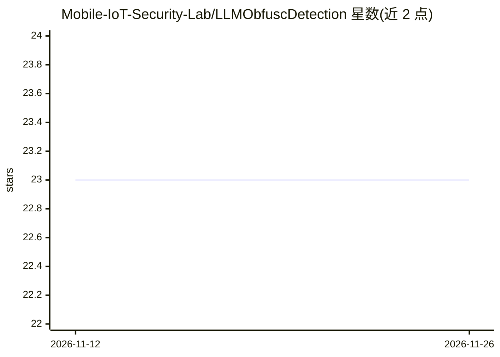

# Mobile-IoT-Security-Lab/LLMObfuscDetection

⭐ 23 · Go · MIT · 推送 2026-11-16 · [GitHub](https://github.com/Mobile-IoT-Security-Lab/LLMObfuscDetection) · 组织维护

**用 LLM 检测与分类 Android 代码混淆的研究框架**

面向研究者与安全分析师的 Android 混淆检测套件，分两个模块：LLMObfuscatorDetector 用 apktool 反编译 APK 为 Smali 后，通过提示词询问 OpenAI GPT-4o、Gemini 或 Ollama 本地模型，判定应用是否混淆及具体混淆技术（反射、常量字符串加密、方法重命名等），含系统/第三方库过滤、统计采样与多数投票；另一模块提供 Ground Truth 数据集资源与 Docker 化的 Trueseeing、APKHunt、SEBASTiAn 等 SAST 工具链。研究中使用的 1,300 个 APK 不随仓库分发。MIT 许可，配套论文可引用。

## 筛选速览

| 维度 | 判定 | 备注 |
|---|---|---|
| AI 角色 | `ai-native` | 本体是模型或模型工具 |
| 许可风险 | `permissive` | MIT |
| 部署形态 | `None` |  |
| 模型依赖 | local-ok | 支持本地模型 |
| 硬件要求 | — | 无带数字的原话,不猜 |
| 安装摩擦 | `low` | 无编译、无系统依赖或容器化 |
| 成熟度 | — | 结构信号不足 |

## 能力要点

- apktool 反编译 + 提示词 LLM 查询检测 Smali 混淆
- 支持 OpenAI GPT-4o、Gemini、Ollama 本地模型
- 自动过滤系统/第三方库并支持采样与多数投票
- Docker 化集成 Trueseeing/APKHunt/SEBASTiAn 传统 SAST 工具

## 适用场景

- 检测 Android 应用是否被混淆及具体混淆技术
- 对比 LLM 方法与传统 SAST 工具的混淆检测效果
- 扩展混淆检测数据集或提示词策略做研究

## 场景标签

`网络安全` · 领域:学习与行业

## 证据(README 行号)

> L31: |**`LLMObfuscatorDetector/`**|Python-based experimental suite that uses LLMs (OpenAI, Gemini, Ollama) to automatica
> L38: Located in `LLMObfuscatorDetector/`, this module leverages advanced static analysis (decompilation of APKs to Smali

## 星数曲线

2026-11-12 23 → 2026-11-26 23（+0）

---
*卡片 v1 · prompt 1.4 · 生成 2026-11-18 · 置信度 high · 依据 README sha `acb4d7bbad27` · [字段定义](../../DATASET.md)*
