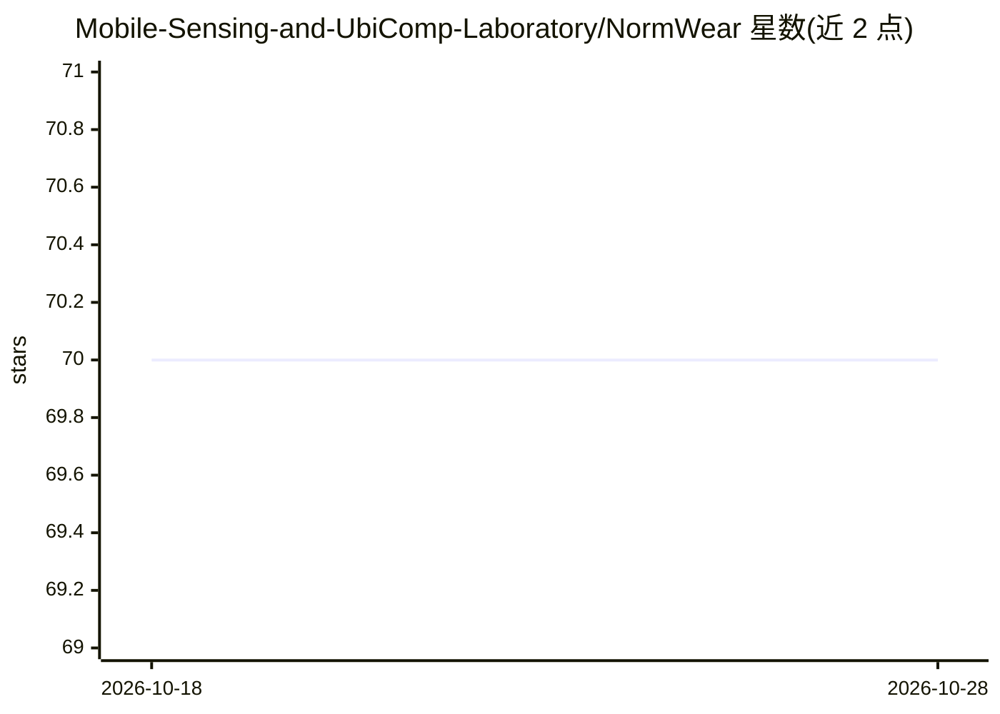

# Mobile-Sensing-and-UbiComp-Laboratory/NormWear

⭐ 70 · Python · Apache-2.0 · 推送 2026-04-27 · [GitHub](https://github.com/Mobile-Sensing-and-UbiComp-Laboratory/NormWear) · 组织维护

**面向可穿戴生理信号的基础模型，支持下游评估与零样本推理**

学术论文（ACM Transactions on Computing for Healthcare）官方实现：NormWear 是在 PPG、ECG、EEG、GSR、IMU 等生理信号上预训练的时序基础模型，提取可穿戴传感表征。提供信号嵌入提取、基于表示对齐匹配的零样本推理、预训练 pipeline、下游评估（11 个公开数据集、18 个应用，涵盖心理健康、体征估计、疾病风险评估）与微调代码。预训练模型权重放在 Release，依赖由 dependencies.txt 指定，下游数据集可另行下载。面向科研用户。

## 筛选速览

| 维度 | 判定 | 备注 |
|---|---|---|
| AI 角色 | `ai-native` | 本体是模型或模型工具 |
| 许可风险 | `permissive` | Apache-2.0 |
| 部署形态 | `None` |  |
| 模型依赖 | — | README 未给出锁定关系 |
| 硬件要求 | — | 无带数字的原话,不猜 |
| 安装摩擦 | `low` | 无编译、无系统依赖或容器化 |
| 成熟度 | — | 结构信号不足 |

## 能力要点

- 在 PPG/ECG/EEG/GSR/IMU 等多模态生理信号上预训练
- 信号嵌入与文本嵌入对齐，支持零样本推理
- 提供预训练、下游评估（11 个数据集/18 个应用）与微调 pipeline
- 支持 stats/chronos/clap/tfc 等多种基线模型的下游对比评估

## 适用场景

- 在自有的可穿戴生理信号数据上提取嵌入或微调
- 心理健康、体征估计、疾病风险等下游任务评估
- 对未见过的穿戴信号任务做零样本推理

## 场景标签

`科研工具` `多模态` `微调` `模型训练` · 领域:学习与行业

## 证据(README 行号)

> L13: This is the official implementation of the paper Toward Foundation Model for Multivariate Wearable Sensing of Physi
> L15: Time-series foundation models have the ability to run inference, mainly forecasting, on any type of time series dat

## 星数曲线

2026-10-18 70 → 2026-10-28 70（+0）

---
*卡片 v1 · prompt 1.4 · 生成 2026-10-24 · 置信度 high · 依据 README sha `cbbec3042509` · [字段定义](../../DATASET.md)*
