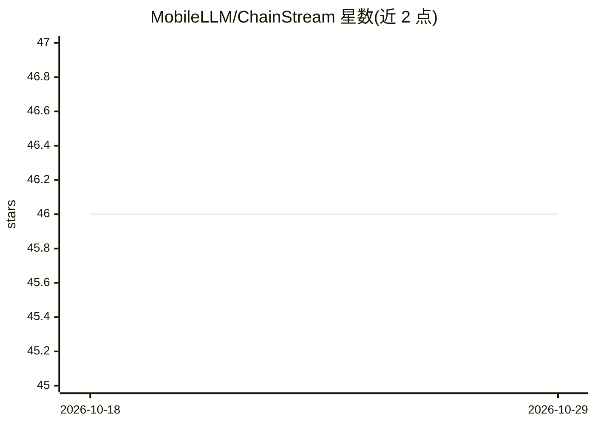

# MobileLLM/ChainStream

⭐ 46 · Python · Apache-2.0 · 推送 2026-04-25 · [GitHub](https://github.com/MobileLLM/ChainStream) · [官网](https://mobilellm.github.io/ChainStream/) · 组织维护 · 中文 README

**流式 LLM agent 框架：移动设备持续感知与共享上下文**

由清华大学 AIR 研究院 AIoT 团队开发的流式 LLM Agent 框架：以数据流（stream）为核心抽象，开发者定义数据源流、转换与监听动作来构建持续感知上下文的 agent；提供自然语言到 ChainStream DSL 的 Agent Generator、agent 存储库、Android 边缘传感器客户端与测试沙箱。通过 pip 从源码安装，运行 start.py 后经 Web 界面浏览 agent 列表与流状态。项目声明仍处于开发中。

## 筛选速览

| 维度 | 判定 | 备注 |
|---|---|---|
| AI 角色 | `ai-ecosystem` | LLM/agent 周边工具 |
| 许可风险 | `permissive` | Apache-2.0 |
| 部署形态 | `library` | 以包/库形式分发 |
| 模型依赖 | — | README 未给出锁定关系 |
| 硬件要求 | — | 无带数字的原话,不猜 |
| 安装摩擦 | `low` | 无编译、无系统依赖或容器化 |
| 成熟度 | `idea` | |

## 能力要点

- 以流为核心抽象构建持续上下文感知 agent（数据源→转换→监听）
- Agent Generator：自然语言编译为 ChainStream DSL
- Android 边缘传感器客户端（ChainStreamClient）
- Web 界面浏览 agent 列表与监控流状态

## 适用场景

- 在移动/边缘设备上构建持续感知上下文的 LLM agent
- 用自然语言生成流式 agent 的 DSL 代码
- 研究与实验流式 agent 的沙箱测试

## 场景标签

`Agent 框架` `代码生成` · 领域:Agent 开发

## 证据(README 行号)

> L3: A Stream-based LLM Agent Framework for Continuous Context Sensing and Sharing
> L62: - Agent Generator: natural language to chainstream DSL compiler
> L72: - ChainStream is designed and developed by the AIoT Team from Institute for AI Industry Research (AIR), Tsinghua Un

## 星数曲线

2026-10-18 46 → 2026-10-29 46（+0）

---
*卡片 v1 · prompt 1.4 · 生成 2026-10-25 · 置信度 mid · 依据 README sha `afeb4ced99c7` · [字段定义](../../DATASET.md)*
