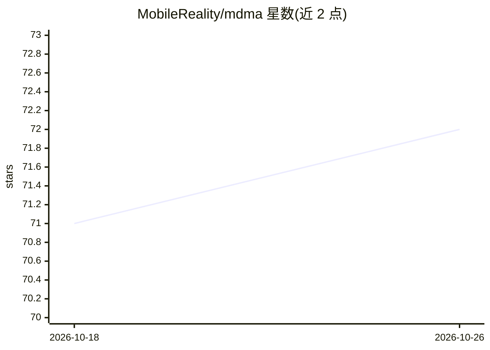

# MobileReality/mdma

⭐ 72 · TypeScript · MIT · 推送 2026-10-23 · [GitHub](https://github.com/MobileReality/mdma) · 组织维护

**让 LLM 输出可交互组件的 Markdown 扩展规范与工具链**

MDMA（Markdown Document with Mounted Applications）用 fenced mdma 代码块扩展 Markdown，使 LLM 可输出表单、表格、审批门、Webhook 等 10 种结构化交互组件，前端经 React 渲染器即时呈现，替代逐用例定制 UI 或解析自由文本。工具链含 parser、runtime、renderer-react、prompt-pack 等 npm 包；MDMA_AUTHOR 提示针对 OpenAI/Anthropic/Google/xAI 多型号适配，MDMA_FIXER 自动修复校验失败的输出；外部数据源机制让模型只写引用不写数据行。面向集成的开发者。

## 筛选速览

| 维度 | 判定 | 备注 |
|---|---|---|
| AI 角色 | `ai-ecosystem` | LLM/agent 周边工具 |
| 许可风险 | `permissive` | MIT |
| 部署形态 | `library` | 以包/库形式分发 |
| 模型依赖 | — | README 未给出锁定关系 |
| 硬件要求 | — | 无带数字的原话,不猜 |
| 安装摩擦 | `low` | 无编译、无系统依赖或容器化 |
| 成熟度 | — | 结构信号不足 |

## 能力要点

- mdma 代码块定义 10 种内置交互组件，React 渲染器开箱渲染
- MDMA_AUTHOR / MDMA_FIXER 提示变体矩阵覆盖多家厂商多型号
- validate() 校验 + 模型定制修复器自动修复 LLM 输出
- 外部数据源机制：LLM 写 { source, params }，数据行由宿主系统解析

## 适用场景

- 在聊天应用中让 AI 直接产出可填写的表单与审批流程
- 把 LLM 对话从纯文本升级为结构化可操作组件
- 用统一 schema 渲染 AI 输出而无需逐场景定制 UI

## 场景标签

`提示工程` · 领域:Agent 开发

## 证据(README 行号)

> L19: AI conversations today are plain text — the user reads a response and manually acts on it. MDMA changes that. When 
> L27: MDMA extends Markdown with interactive components defined in fenced `mdma` code blocks. A regular Markdown file bec
> L203: 10 built-in component types, all rendered out of the box by `@mobile-reality/mdma-renderer-react`:

## 星数曲线

2026-10-18 71 → 2026-10-26 72（+1）

---
*卡片 v1 · prompt 1.4 · 生成 2026-10-24 · 置信度 high · 依据 README sha `a0eb9c7ba749` · [字段定义](../../DATASET.md)*
