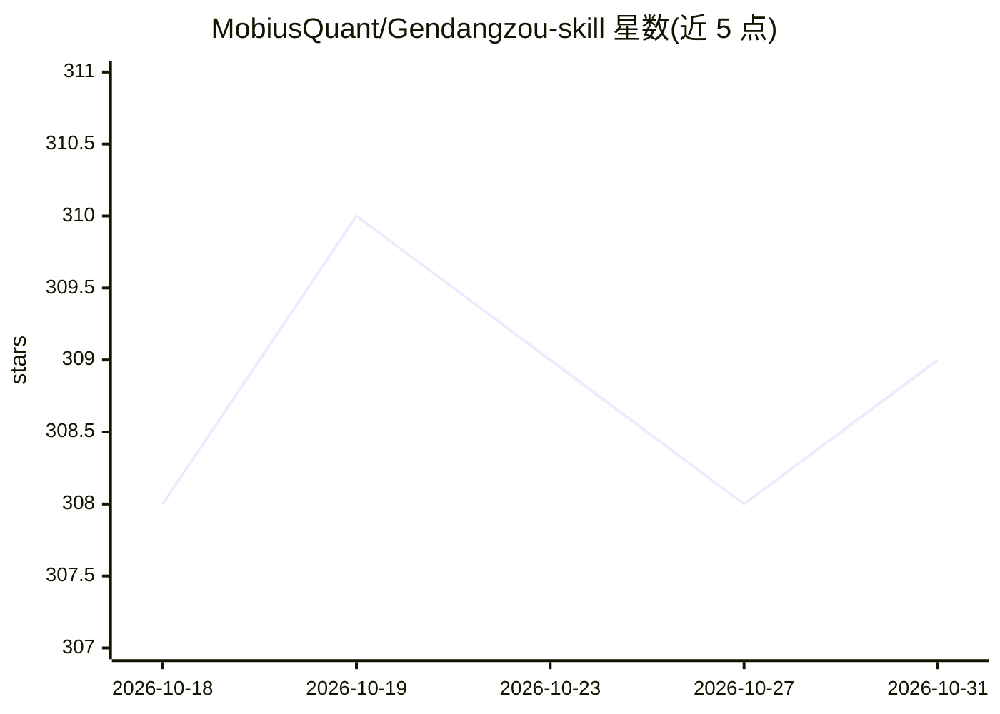

# MobiusQuant/Gendangzou-skill

⭐ 309 · Python · Apache-2.0 · 推送 2026-07-28 · [GitHub](https://github.com/MobiusQuant/Gendangzou-skill) · [官网](https://gendangzou.mobiusquant.ai) · 组织维护 · 中文 README

**给 AI Agent 的可溯源 A 股板块研究 Skill 与 API 基座**

由 MobiusQuant 维护的 Agent Skill 通用包，将 A 股板块相关的政策、权威媒体、市场关注、资金信号及公司与 ETF 映射封装为可查询能力，区分实时材料与每日可复现快照，关键判断保留来源、日期、稳定 ID 和证据链。支持 Claude Code、Codex、OpenClaw 等平台加载，提供统一 API SDK、8 个内置应用（日报、周报、板块雷达、央视节目解读等）与应用包规范供二次开发。需要 Python 3.10+ 与 HTTPS 访问 GitHub 及其 API 域名；结论限定在板块层面，不提供个股或 ETF 推荐。

## 筛选速览

| 维度 | 判定 | 备注 |
|---|---|---|
| AI 角色 | `ai-ecosystem` | LLM/agent 周边工具 |
| 许可风险 | `permissive` | Apache-2.0 |
| 部署形态 | `None` |  |
| 模型依赖 | — | README 未给出锁定关系 |
| 硬件要求 | — | 无带数字的原话,不猜 |
| 安装摩擦 | `low` | 无编译、无系统依赖或容器化 |
| 成熟度 | — | 结构信号不足 |

## 能力要点

- 实时材料与每日快照分离，判断保留来源/日期/稳定 ID 证据链
- 公司与板块、ETF 与板块的映射审计（基于官方 PCF 篮子等依据）
- 统一 API SDK 与独立应用包规范支持二次开发
- 支持 Claude Code/Codex/OpenClaw/Hermes/WorkBuddy 五类平台加载

## 适用场景

- 让 Agent 追踪政策与权威媒体材料并归并到板块
- 回看与复现指定日期的板块状态和三信号变化
- 核查公司入板依据与 ETF 板块暴露
- 基于 API SDK 搭建自有板块监控或研究应用

## 场景标签

`金融量化` · 领域:学习与行业

## 证据(README 行号)

> L59: `gendangzou-skill` 是跟党走 A 股板块数据能力的 Agent 封装，也是面向二次建设的
> L156:     S["政策 · 媒体 · 市场 · 资金 · 公司 · ETF"] --> A["跟党走 API"]

## 星数曲线

2026-10-18 308 → 2026-10-31 309（+1）

---
*卡片 v1 · prompt 1.4 · 生成 2026-10-21 · 置信度 high · 依据 README sha `a1a51d7e2d64` · [字段定义](../../DATASET.md)*
