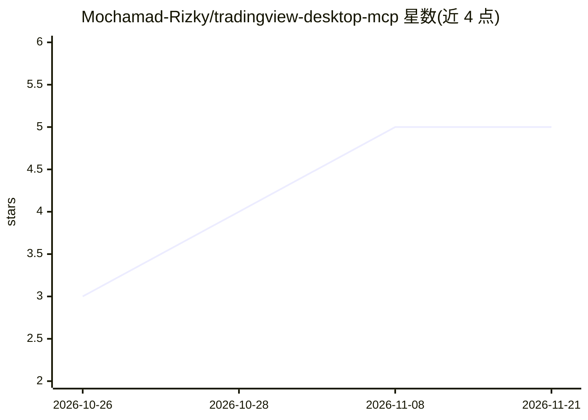

# Mochamad-Rizky/tradingview-desktop-mcp

⭐ 5 · TypeScript · MIT · 推送 2026-11-01 · [GitHub](https://github.com/Mochamad-Rizky/tradingview-desktop-mcp) · [官网](https://www.npmjs.com/package/tradingview-desktop-mcp) · 个人维护

**让 AI 助手读取并控制本地 TradingView Desktop 的 MCP 服务器**

通过 Chrome DevTools Protocol 驱动已登录的本地 TradingView Desktop 应用，提供应用控制、图表状态、行情数据、指标管理、Pine Script 编辑与编译、策略回测读取、画线、警报、自选股、截图与 bar replay 等工具，另含资源、提示与实时 Web dashboard。以 npm 包分发，需 TradingView Desktop 与 Node.js 20.19+，支持多客户端配置生成；仅自动化本地应用，不下单交易，状态为 pre-1.0，工具名可能变更。

## 筛选速览

| 维度 | 判定 | 备注 |
|---|---|---|
| AI 角色 | `ai-ecosystem` | LLM/agent 周边工具 |
| 许可风险 | `permissive` | MIT |
| 部署形态 | `library` | 以包/库形式分发 |
| 模型依赖 | — | README 未给出锁定关系 |
| 硬件要求 | — | 无带数字的原话,不猜 |
| 安装摩擦 | `low` | 无编译、无系统依赖或容器化 |
| 成熟度 | `idea` | |

## 能力要点

- 通过 --remote-debugging-port 与 CDP 控制本地已登录的 TradingView Desktop
- 工具覆盖图表、行情、指标、Pine Script 编译、回测、画线、警报与自选股
- config 命令为 Claude Desktop/Cursor/VS Code 等多客户端生成配置片段
- 不放置交易订单，也代登录或绕过套餐限制

## 适用场景

- 用自然语言让 AI 助手读取图表并添加指标或画支撑线
- 让 AI 编写并编译 Pine Script 指标
- 从助手会话中查看策略回测结果与设置价格警报

## 场景标签

`金融量化` `浏览器自动化` · 领域:效率与自动化

## 证据(README 行号)

> L17: An MCP server that lets AI assistants read and control the
> L79: Nothing else is installed: the clients below start the server with `npx -y tradingview-desktop-mcp`,
> L117: The default transport is stdio, where stdout carries only MCP messages and logs go to stderr. The

## 星数曲线

2026-10-26 3 → 2026-11-21 5（+2）

---
*卡片 v1 · prompt 1.4 · 生成 2026-11-21 · 置信度 high · 依据 README sha `f9b9eb733229` · [字段定义](../../DATASET.md)*
