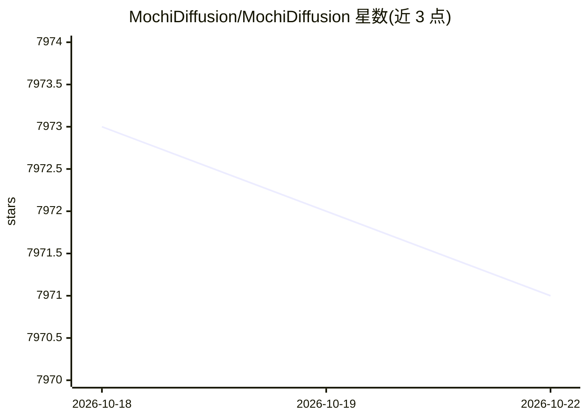

# MochiDiffusion/MochiDiffusion

⭐ 7,971 · Swift · GPL-3.0 · 推送 2026-10-18 · [GitHub](https://github.com/MochiDiffusion/MochiDiffusion) · 个人维护 · 中文 README

**在 Mac 上本地运行 Stable Diffusion / FLUX.2 Klein 生图的原生应用**

基于 SwiftUI 的原生 macOS 桌面应用，使用 Apple 的 Core ML Stable Diffusion 实现与 Iris pipeline（Metal GPU 加速）在本地离线生成图像，支持 Stable Diffusion（含 ControlNet、img2img）与 FLUX.2 Klein（4B/9B 蒸馏版，最多 4 张输入图）。图像保存为 PNG 并附带生成设置，兼容 AUTOMATIC1111 类工具与 Civitai 上传读取。需要用户提供转换好的 Core ML 模型或 FLUX.2 Klein 模型；限制：Core ML 模型仅能生成转换时固定的图像尺寸，首次运行 Neural Engine 编译缓存可能耗时约 2 分钟。

## 筛选速览

| 维度 | 判定 | 备注 |
|---|---|---|
| AI 角色 | `ai-native` | 本体是模型或模型工具 |
| 许可风险 | `viral` | GPL-3.0 |
| 部署形态 | `None` |  |
| 模型依赖 | — | README 未给出锁定关系 |
| 硬件要求 | — | 无带数字的原话,不猜 |
| 安装摩擦 | `low` | 无编译、无系统依赖或容器化 |
| 成熟度 | — | 结构信号不足 |

## 能力要点

- 本地完全离线生成，不收集数据或遥测
- Core ML Stable Diffusion 支持 CPU&Neural Engine / CPU&GPU 两种计算单元
- FLUX.2 Klein 无需模型转换，最多 4 张输入图并自动调整尺寸
- 生成图像附带 AUTOMATIC1111 兼容的元数据

## 适用场景

- 在 Apple Silicon Mac 上离线生成 Stable Diffusion 图像
- 使用 ControlNet 或起始图像进行引导生成
- 本地运行 FLUX.2 Klein 模型生图并用内置画廊管理

## 场景标签

`图像生成` · 领域:内容生成

## 证据(README 行号)

> L11: Mochi Diffusion is a native macOS app for generating images locally using Apple's Core ML Stable Diffusion implemen
> L15: - Generate images locally and completely offline

## 星数曲线

2026-10-18 7,973 → 2026-10-22 7,971（-2）

---
*卡片 v1 · prompt 1.4 · 生成 2026-10-20 · 置信度 high · 依据 README sha `c30adb812a45` · [字段定义](../../DATASET.md)*
