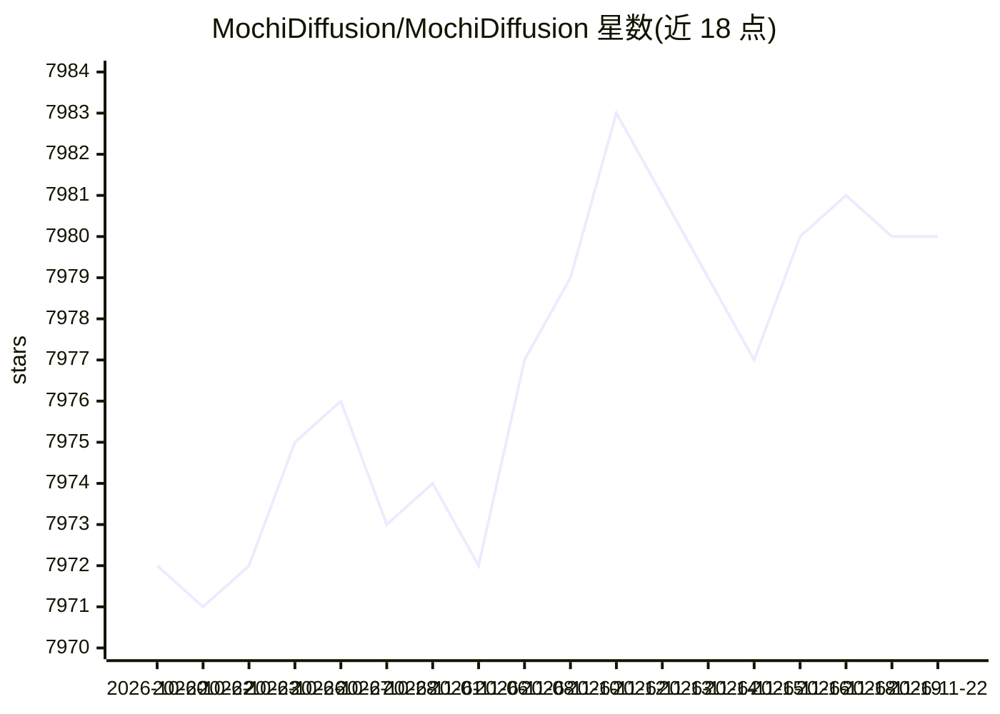

# MochiDiffusion/MochiDiffusion

⭐ 7,980 · Swift · GPL-3.0 · 推送 2026-11-15 · [GitHub](https://github.com/MochiDiffusion/MochiDiffusion) · 组织维护 · 中文 README

**Mac 本地原生运行 Stable Diffusion 与 FLUX.2 Klein 的图像生成应用**

原生 macOS SwiftUI 应用，使用 Apple Core ML Stable Diffusion 实现在本地离线生成图像，Core ML 路径针对 Apple Silicon 的 Neural Engine 优化（速度与内存效率），每个 Core ML 模型在转换时固定图像尺寸；另通过 Iris pipeline 以 Metal GPU 加速运行无需转换的 FLUX.2 Klein 与 Z-Image Turbo 模型，并可连接 Draw Things 应用或 gRPC 服务器生图。生成图像保存为 PNG 并写入生成参数，兼容 AUTOMATIC1111 可读取的格式；应用不收集数据与遥测。需 Apple Silicon 与 macOS 15.6+，可下载安装或从源码构建。

## 筛选速览

| 维度 | 判定 | 备注 |
|---|---|---|
| AI 角色 | `ai-native` | 本体是模型或模型工具 |
| 许可风险 | `viral` | GPL-3.0 |
| 部署形态 | `None` |  |
| 模型依赖 | — | README 未给出锁定关系 |
| 硬件要求 | — | 无带数字的原话,不猜 |
| 安装摩擦 | `low` | 无编译、无系统依赖或容器化 |
| 成熟度 | — | 结构信号不足 |

## 能力要点

- Core ML Stable Diffusion 本地离线生图，支持 CPU & Neural Engine / CPU & GPU 计算单元选项
- Iris pipeline 以 Metal GPU 加速运行 FLUX.2 Klein（最多 4 张输入图）与 Z-Image Turbo（仅 t2i）
- 可连接同机或局域网内 Draw Things 应用/gRPC 服务器生图，支持其 LoRA 与参考图
- PNG 保存生成设置，兼容 AUTOMATIC1111 与 Civitai 上传读取

## 适用场景

- 在 Mac 上完全离线生成图像，不上传云端
- 在 Apple Silicon 上用 Neural Engine 快速出图并降低内存占用
- 连接局域网 Draw Things 服务器，把生图放到其他机器的硬件上
- 管理本地模型库与内置图库（导入/保存/同步）

## 场景标签

`图像生成` · 领域:内容生成

## 证据(README 行号)

> L11: Mochi Diffusion is a native macOS app for generating images locally using Apple's Core ML Stable Diffusion implemen
> L127: - Apple Silicon (M1 and later)
> L18: - macOS native app using SwiftUI

## 星数曲线

2026-10-20 7,972 → 2026-11-22 7,980（+8）

---
*卡片 v1 · prompt 1.4 · 生成 2026-11-22 · 置信度 high · 依据 README sha `8b63862dfa2f` · [字段定义](../../DATASET.md)*
