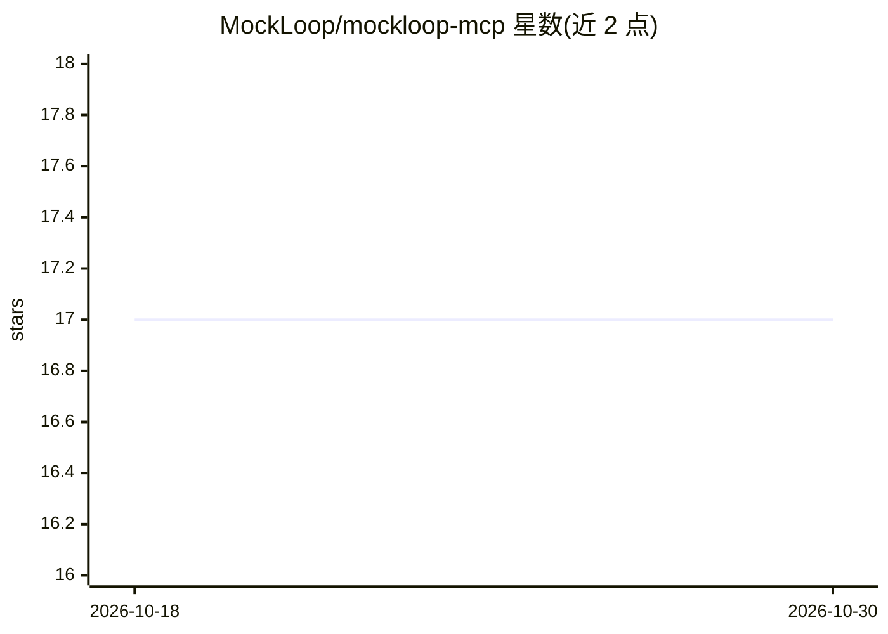

# MockLoop/mockloop-mcp

⭐ 17 · Python · MIT · 推送 2026-10-29 · [GitHub](https://github.com/MockLoop/mockloop-mcp) · [官网](https://mockloop.com) · 组织维护

**MCP 服务器：从 OpenAPI 规范生成 Mock API 并做测试分析**

MockLoop MCP 是面向 AI 辅助 API 开发工作流的 Model Context Protocol (MCP) 服务器：从 OpenAPI 规范 URL 或本地文件生成 FastAPI mock 服务器（双端口架构，mock API 与 Admin UI 分离），提供 30 个 MCP 工具覆盖测试执行、上下文管理、日志查询与 AI 分析，并支持 mock/proxy/hybrid 三种模式的代理切换。可接入 Cline、Claude Desktop 等 MCP 客户端，也提供 LangGraph 集成。通过 pip 安装，容器化部署需 Docker。

## 筛选速览

| 维度 | 判定 | 备注 |
|---|---|---|
| AI 角色 | `ai-ecosystem` | LLM/agent 周边工具 |
| 许可风险 | `permissive` | MIT |
| 部署形态 | `self-host` | docker 或自建部署 |
| 模型依赖 | — | README 未给出锁定关系 |
| 硬件要求 | — | 无带数字的原话,不猜 |
| 安装摩擦 | `low` | 无编译、无系统依赖或容器化 |
| 成熟度 | — | 结构信号不足 |

## 能力要点

- 从 OpenAPI 规范生成 FastAPI mock 服务器（双端口架构）
- 30 个 MCP 工具：测试执行、上下文管理、日志分析、场景管理
- mock/proxy/hybrid 代理模式，支持 mock 与真实 API 响应对比
- 支持 API Key/Bearer/Basic/OAuth2 多种认证方案

## 适用场景

- 让 AI 客户端（Claude Desktop/Cline）自动生成并管理 mock API 用于开发测试
- 前端/测试团队在真实后端就绪前用 mock 数据联调
- 对比 mock 与生产 API 响应以验证一致性

## 场景标签

`代码生成` · 领域:编码与开发

## 证据(README 行号)

> L16: **The world's first AI-native API testing platform** powered by the Model Context Protocol (MCP). MockLoop MCP revo
> L125: - An MCP-compatible client (Cline, Claude Desktop, etc.)
> L329: MockLoop MCP provides native integration with popular AI frameworks:

## 星数曲线

2026-10-18 17 → 2026-10-30 17（+0）

---
*卡片 v1 · prompt 1.4 · 生成 2026-10-30 · 置信度 mid · 依据 README sha `5400cd551c1c` · [字段定义](../../DATASET.md)*
