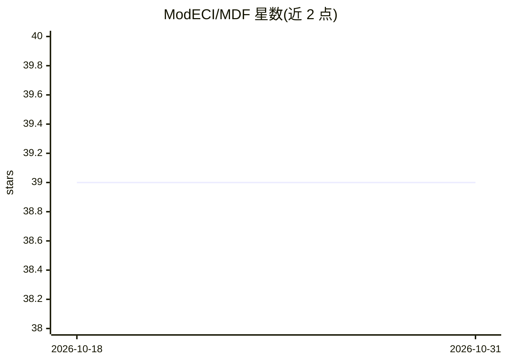

# ModECI/MDF

⭐ 39 · Python · Apache-2.0 · 推送 2026-10-28 · [GitHub](https://github.com/ModECI/MDF) · [官网](https://mdf.readthedocs.io) · 组织维护

**跨环境交换计算模型的开放标准与 Python 工具集**

MDF 是面向计算神经科学、认知科学与机器学习的模型描述格式标准及配套 Python 工具：以 Model-Graph-Node-Edge-Condition 等核心元素描述计算图，支持 JSON/YAML/BSON 序列化，并提供用于创建、校验模型的基础执行引擎。主要目的是促成模型在不同编程环境间的双向导入/导出，而非作为通用仿真环境或编程语言。支持环境包括 PyTorch、ONNX、NeuroML 等。由 ModECI 维护，获 NSF Convergence Accelerator 资助。

## 筛选速览

| 维度 | 判定 | 备注 |
|---|---|---|
| AI 角色 | `ai-ecosystem` | LLM/agent 周边工具 |
| 许可风险 | `permissive` | Apache-2.0 |
| 部署形态 | `library` | 以包/库形式分发 |
| 模型依赖 | — | README 未给出锁定关系 |
| 硬件要求 | — | 无带数字的原话,不猜 |
| 安装摩擦 | `low` | 无编译、无系统依赖或容器化 |
| 成熟度 | `idea` | |

## 能力要点

- 以 Models/Graphs/Nodes/Edges/Conditions 为核心的计算图描述标准
- 支持 JSON/YAML/BSON 序列化表示
- Python API 提供模型创建、加载、校验与基础执行引擎
- 双向导入/导出 PyTorch、ONNX、NeuroML 等环境

## 适用场景

- 在计算神经科学与机器学习环境之间迁移计算模型
- 以标准序列化格式保存和交换模型描述
- 校验并检查模型的图结构与条件执行逻辑

## 场景标签

 · 领域:计算神经科学/机器学习互操作

## 证据(README 行号)

> L23: MDF is an open source, community-supported standard and associated library of tools for expressing computational mo
> L27: The MDF Python API can be used to create or load an MDF model for inspection and validation. It also includes a bas
> L31: The implementation and dissemination of the MDF language and associated tools is being carried out by the Model Exc

## 星数曲线

2026-10-18 39 → 2026-10-31 39（+0）

---
*卡片 v1 · prompt 1.4 · 生成 2026-10-25 · 置信度 high · 依据 README sha `85bbb1145f44` · [字段定义](../../DATASET.md)*
