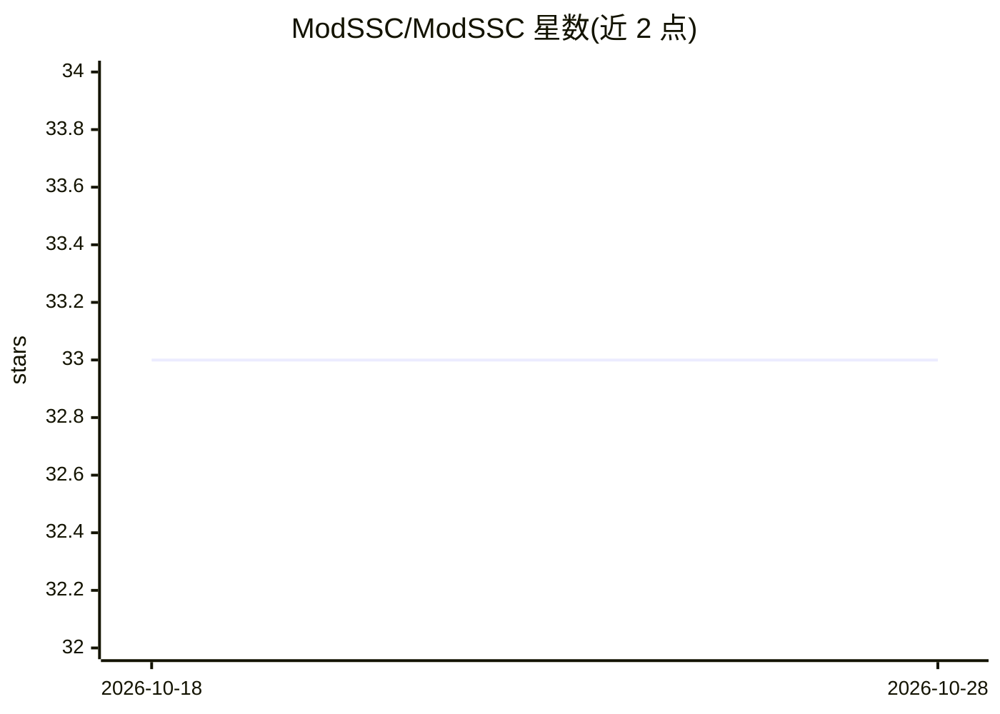

# ModSSC/ModSSC

⭐ 33 · Python · MIT · 推送 2026-09-09 · [GitHub](https://github.com/ModSSC/ModSSC) · 个人维护

**多模态半监督分类研究的模块化框架**

面向学术研究的半监督分类（SSC）模块化框架，覆盖文本、图像、表格、图、音频五种模态。提供可复现的实验管线与可扩展的方法注册表，支持转导式与归纳式学习两类设定；附 CLI 与 API 文档、examples 脚本与 notebooks 交互示例。基准配置通过环境变量（MODSSC_OUTPUT_DIR 等）指定输出与缓存目录。由研究者以 PyPI 包形式发布，配套 arXiv 论文供引用。

## 筛选速览

| 维度 | 判定 | 备注 |
|---|---|---|
| AI 角色 | `ai-native` | 本体是模型或模型工具 |
| 许可风险 | `permissive` | MIT |
| 部署形态 | `library` | 以包/库形式分发 |
| 模型依赖 | — | README 未给出锁定关系 |
| 硬件要求 | — | 无带数字的原话,不猜 |
| 安装摩擦 | `low` | 无编译、无系统依赖或容器化 |
| 成熟度 | — | 结构信号不足 |

## 能力要点

- 覆盖文本/图像/表格/图/音频五种模态的半监督分类
- 可复现管线与可扩展方法注册表
- 支持转导式（transductive）与归纳式（inductive）学习
- 提供 CLI、API 文档、示例脚本与交互式 notebooks

## 适用场景

- 在多种数据模态上复现半监督分类方法的基准实验
- 研究者在统一框架下注册和扩展新的 SSC 方法
- 学习半监督分类概念并运行入门示例

## 场景标签

`模型评测` · 领域:评测与运维

## 证据(README 行号)

> L10: ModSSC is a modular framework for semi-supervised classification across heterogeneous
> L11: modalities (text, vision, tabular, graph, audio). It is designed for academic research with

## 星数曲线

2026-10-18 33 → 2026-10-28 33（+0）

---
*卡片 v1 · prompt 1.4 · 生成 2026-10-25 · 置信度 high · 依据 README sha `07da8dc208b2` · [字段定义](../../DATASET.md)*
