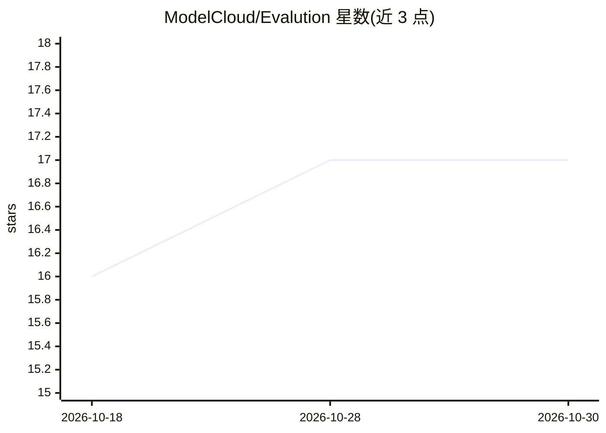

# ModelCloud/Evalution

⭐ 17 · Python · Apache-2.0 · 推送 2026-10-26 · [GitHub](https://github.com/ModelCloud/Evalution) · [官网](https://x.com/Qubitium) · 组织维护

**多引擎 LLM 基准评测工具包，面向快速、忠于基准的模型评估**

Evalution 是 Python 编写的 LLM 评测工具包，内置 153 个基准套件家族，支持 Transformers、vLLM、SGLang、TensorRT-LLM、LlamaCpp、Tinygrad、OpenVINO 等 11 种推理引擎，默认尝试连续批处理。提供 Python、YAML、CLI 三种使用形态，支持单模型运行与左右分道对比模式，结果携带 Evalution 及各运行时包的版本映射以保障可复现；另含沙箱化 agentic 基准运行时与工具调用解析。默认安装仅含少量核心依赖，各后端依赖按需安装。面向需要跨引擎跑基准与回归测试的 LLM 开发者。

## 筛选速览

| 维度 | 判定 | 备注 |
|---|---|---|
| AI 角色 | `ai-ecosystem` | LLM/agent 周边工具 |
| 许可风险 | `permissive` | Apache-2.0 |
| 部署形态 | `self-host` | docker 或自建部署 |
| 模型依赖 | local-ok | 支持本地模型 |
| 硬件要求 | — | 无带数字的原话,不猜 |
| 安装摩擦 | `low` | 无编译、无系统依赖或容器化 |
| 成熟度 | — | 结构信号不足 |

## 能力要点

- 11 种推理引擎、153 个内置基准套件家族
- Python / YAML / CLI 共用同一 API 形态，支持双模型对比模式
- 每份结果附带版本映射（含 local-git-<commit> 后缀）以保障可复现
- 仓库含 215 个 GPU 基准回归测试，并附 RTX 4090 / A100 基线

## 适用场景

- 在多个推理引擎上跑同一组基准并对比模型成绩
- 通过 YAML/CLI 配置可复现的评测流水线
- 对 Llama 等模型做 GPU 基准回归测试
- 评测 agentic 与工具调用能力（沙箱 DockerAgentRuntime / SmolVmAgentRuntime）

## 场景标签

`模型评测` · 领域:评测与运维

## 证据(README 行号)

> L5: Evalution is a modern LLM evaluation toolkit for fast, benchmark-faithful, multi-engine model evaluation. 🚀
> L38: - 🚂 Multi-engine out of the box: `Transformers`, `TransformersCompat`, `VLLM`, `SGLang`, `TensorRTLLM`, `OpenAIComp

## 星数曲线

2026-10-18 16 → 2026-10-30 17（+1）

---
*卡片 v1 · prompt 1.4 · 生成 2026-10-30 · 置信度 mid · 依据 README sha `4aa0b4f6fa8f` · [字段定义](../../DATASET.md)*
