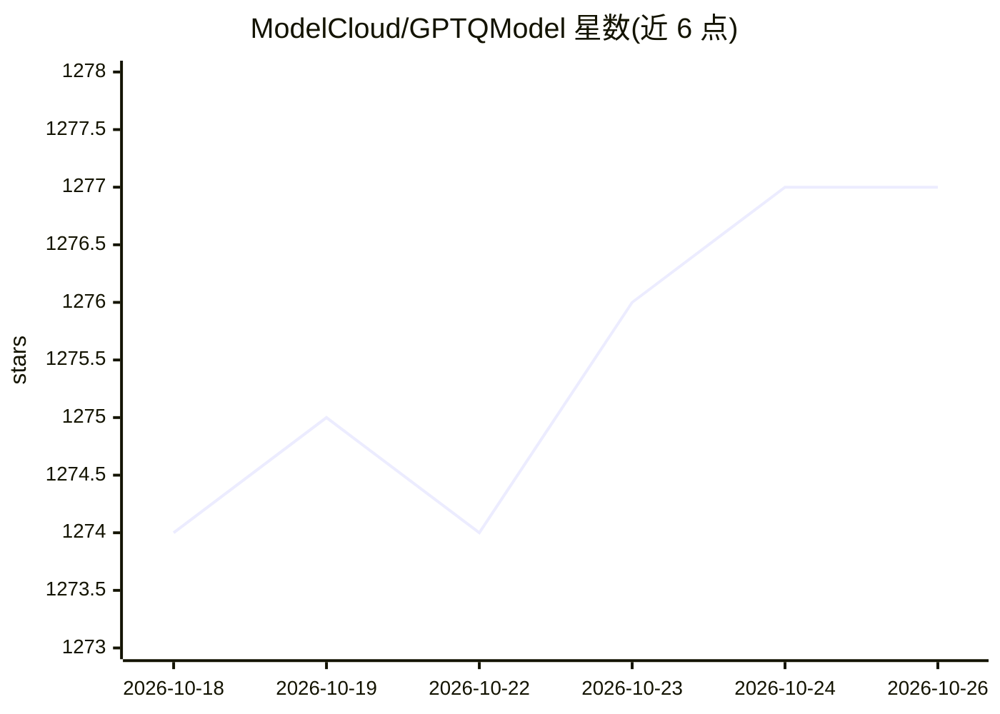

# ModelCloud/GPTQModel

⭐ 1,277 · Python · NOASSERTION · 推送 2026-10-24 · [GitHub](https://github.com/ModelCloud/GPTQModel) · [官网](https://x.com/Qubitium) · 组织维护

**面向 LLM 的多算法量化/验证/部署工具包，覆盖多硬件与推理运行时**

GPTQModel 提供统一的 LLM 量化平台：校准、量化、质量评估、模型转换与加速推理。支持 GPTQ、AWQ、ParoQuant、QQQ、GGUF、FP8、EXL3、GPTAQ、EoRA、FOEM 等方法，运行于 NVIDIA CUDA、AMD ROCm、Intel XPU、华为昇腾 NPU、Apple MPS 与 CPU；与 HF Transformers、Optimum、Peft 原生集成，并可接入 vLLM 与 SGLang 推理。方法/格式/后端/内核分层模块化，支持逐层混合量化与 MoE 路由感知控制。以 Python 包发布于 PyPI。

## 筛选速览

| 维度 | 判定 | 备注 |
|---|---|---|
| AI 角色 | `ai-ecosystem` | LLM/agent 周边工具 |
| 许可风险 | `none` | NOASSERTION |
| 部署形态 | `library` | 以包/库形式分发 |
| 模型依赖 | local-ok | 支持本地模型 |
| 硬件要求 | — | 无带数字的原话,不猜 |
| 安装摩擦 | `high` | 编译与系统依赖俱全 |
| 成熟度 | — | 结构信号不足 |

## 能力要点

- 统一生命周期：校准→量化→验证→保存→加载→服务，覆盖 10+ 种量化方法
- 跨硬件支持：CUDA、ROCm、Intel XPU、华为昇腾 NPU、Apple MPS、Intel/AMD/Apple CPU
- 与 Transformers/Optimum/Peft 原生集成，vLLM 与 SGLang 推理接入
- 逐层/逐模块混合量化控制、多 GPU Data Parallelism 与 free-threading Python 3.13t 优化

## 适用场景

- 对开源 LLM 做 GPTQ/AWQ/GGUF 等量化压缩以降低显存占用
- 量化后在 vLLM 或 SGLang 上部署推理服务
- 对不同层/模块设置差异化量化配置并做量化后质量回归验证
- 在 AMD/Intel/昇腾/Apple 等非 NVIDIA 硬件上量化运行模型

## 场景标签

`模型量化` · 领域:训练与推理

## 证据(README 行号)

> L3:  An extensible platform for LLM quantization, validation, and deployment. GPTQ, AWQ, ParoQuant, GGUF, FP8, EXL3, QQQ
> L39: GPT-QModel provides a consistent API for calibration, quantization, quality evaluation, model conversion, and accel
> L94: * 🚀 vLLM and SGLang inference integration for quantized models. SGLang supports GPTQ `FORMAT.GPTQ`/`FORMAT.GPTQ_V2`

## 星数曲线

2026-10-18 1,274 → 2026-10-26 1,277（+3）

---
*卡片 v1 · prompt 1.4 · 生成 2026-10-21 · 置信度 high · 依据 README sha `890939cdb386` · [字段定义](../../DATASET.md)*
