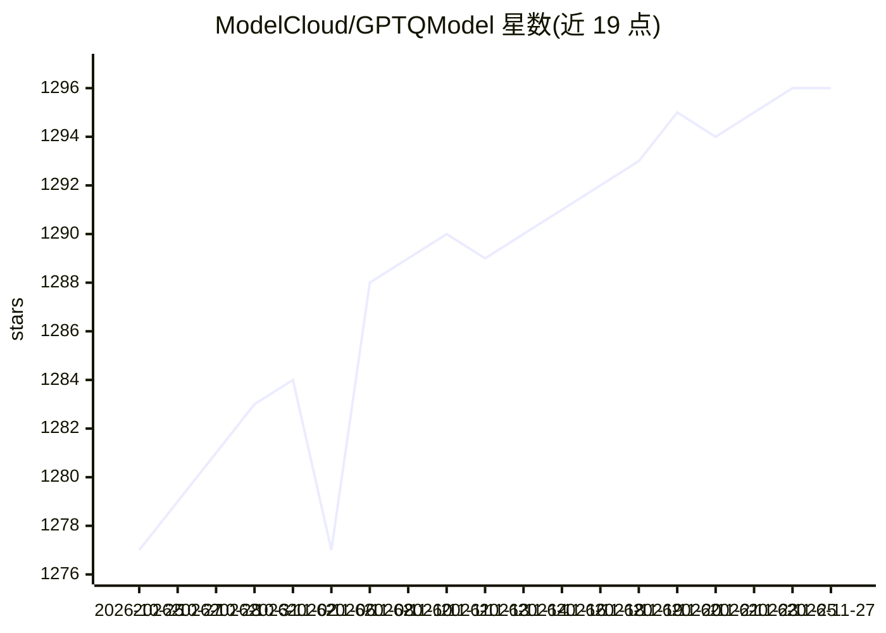

# ModelCloud/GPTQModel

⭐ 1,296 · Python · NOASSERTION · 推送 2026-11-26 · [GitHub](https://github.com/ModelCloud/GPTQModel) · [官网](https://x.com/Qubitium) · 组织维护

**LLM 量化压缩工具包：支持多硬件加速的校准、量化与推理**

将校准、量化、评估、转换与加速推理整合为单一工作流：从预训练模型出发选择压缩配方，验证质量并保存检查点用于本地推理或部署引擎。支持 GPTQ、AWQ、QQQ、EXL3、FP8、GGUF 等多种量化方法，覆盖 Nvidia CUDA、AMD ROCm、Intel XPU、Tenstorrent、华为昇腾 NPU 及多家 CPU 平台，并可与 HF Transformers、vLLM、SGLang 配合。通过 PyPI 分发，新版本持续增加模型与内核支持。

## 筛选速览

| 维度 | 判定 | 备注 |
|---|---|---|
| AI 角色 | `ai-ecosystem` | LLM/agent 周边工具 |
| 许可风险 | `none` | NOASSERTION |
| 部署形态 | `library` | 以包/库形式分发 |
| 模型依赖 | local-ok | 支持本地模型 |
| 硬件要求 | — | 无带数字的原话,不猜 |
| 安装摩擦 | `medium` | 含编译或系统依赖之一 |
| 成熟度 | — | 结构信号不足 |

## 能力要点

- 统一平台覆盖校准、量化、评估、转换与加速推理
- 支持 GPTQ/AWQ/QQQ/EXL3/FP8/GGUF/MACaQ 等多种量化方法
- 硬件覆盖 CUDA、ROCm、XPU、Tenstorrent、昇腾 NPU 与 CPU
- GGUF 支持单文件 llama.cpp 打包与 CPU 零拷贝

## 适用场景

- 把预训练大模型压缩到低比特并保存检查点部署
- 在国产 NPU 或非 Nvidia 硬件上运行量化推理
- 评估不同压缩配方对模型质量的影响

## 场景标签

`模型量化` · 领域:训练与推理

## 证据(README 行号)

> L3:  An extensible platform for LLM quantization. Compress, evaluate, and run models across supported GPUs, accelerators
> L74: GPT-QModel brings calibration, quantization, evaluation, conversion, and accelerated
> L77: compatible deployment engine.

## 星数曲线

2026-10-25 1,277 → 2026-11-27 1,296（+19）

---
*卡片 v1 · prompt 1.4 · 生成 2026-11-27 · 置信度 high · 依据 README sha `5747297fed20` · [字段定义](../../DATASET.md)*
