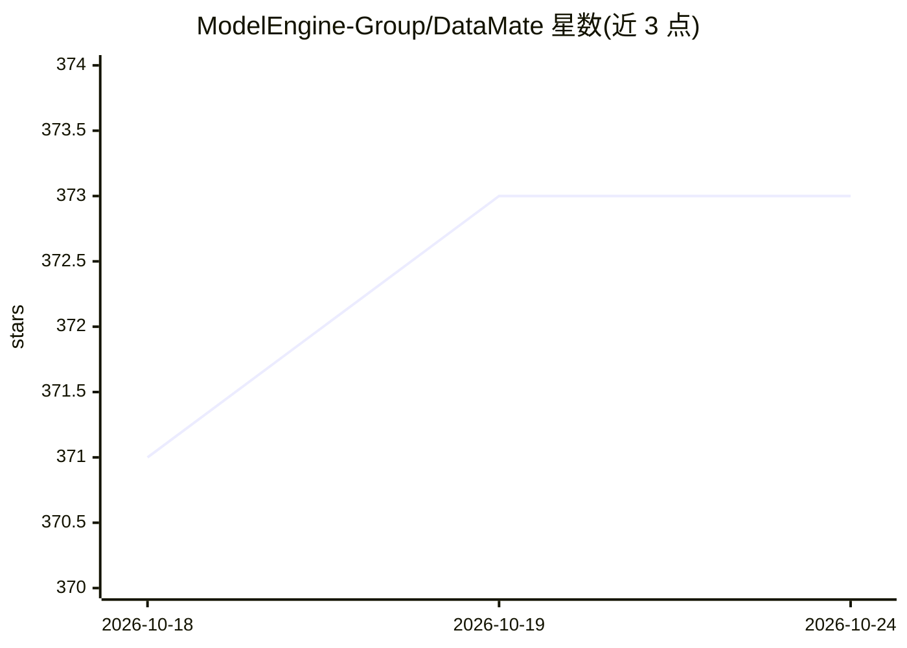

# ModelEngine-Group/DataMate

⭐ 373 · TypeScript · MIT · 推送 2026-10-15 · [GitHub](https://github.com/ModelEngine-Group/DataMate) · [官网](https://github.com/ModelEngine-Group/DataMate) · 组织维护 · 中文 README

**面向微调与 RAG 的企业级数据处理一体平台**

企业级数据处理平台，服务模型微调与 RAG 检索场景，覆盖数据采集、数据管理、算子市场、数据清洗、数据合成、数据标注、数据评估与知识生成等模块，支持拖拽式可视化编排工作流与自定义算子。部署方式为 Docker/Docker-Compose 或 Kubernetes/Helm（K8s 需 Sealed Secrets Controller），通过 make install 引导；可选部署 Label Studio 标注工具、Mineru PDF 处理与 DeerFlow LLM 服务；前端访问 localhost:30000。MIT 许可。

## 筛选速览

| 维度 | 判定 | 备注 |
|---|---|---|
| AI 角色 | `ai-ecosystem` | LLM/agent 周边工具 |
| 许可风险 | `permissive` | MIT |
| 部署形态 | `self-host` | docker 或自建部署 |
| 模型依赖 | — | README 未给出锁定关系 |
| 硬件要求 | — | 无带数字的原话,不猜 |
| 安装摩擦 | `low` | 无编译、无系统依赖或容器化 |
| 成熟度 | — | 结构信号不足 |

## 能力要点

- 八大数据模块：采集、管理、清洗、合成、标注、评估、知识生成等
- 拖拽式可视化数据流程编排
- 内置算子市场并支持自定义算子
- Docker-Compose 与 Kubernetes/Helm 双部署路径，支持离线镜像下载

## 适用场景

- 为模型微调准备和管理训练数据
- 构建 RAG 知识库的数据清洗与知识生成流水线
- 通过可视化编排组织多阶段数据处理任务

## 场景标签

`工作流自动化` · 领域:效率与自动化

## 证据(README 行号)

> L11: **DataMate is an enterprise-level data processing platform for model fine-tuning and RAG retrieval, supporting core
> L21: - **Core Modules**: Data Collection, Data Management, Operator Marketplace, Data Cleaning, Data Synthesis, Data

## 星数曲线

2026-10-18 371 → 2026-10-24 373（+2）

---
*卡片 v1 · prompt 1.4 · 生成 2026-10-21 · 置信度 high · 依据 README sha `3ef2d191c944` · [字段定义](../../DATASET.md)*
