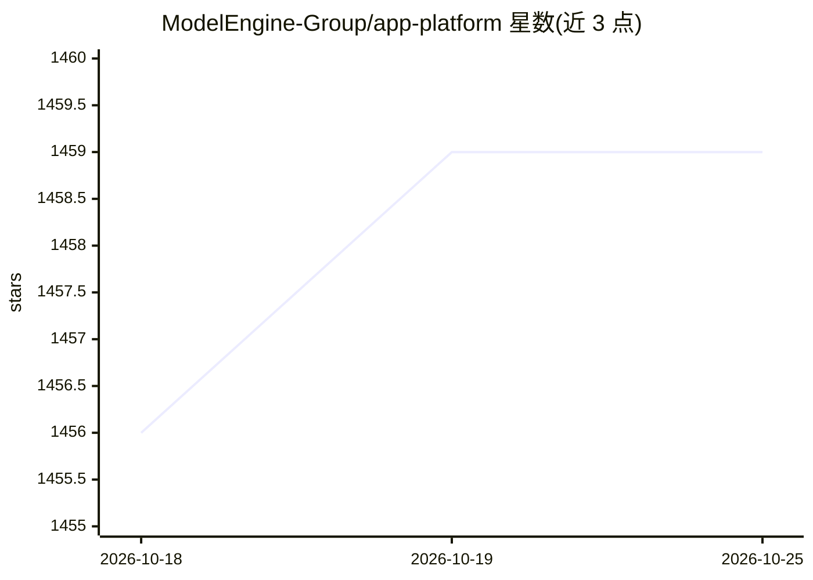

# ModelEngine-Group/app-platform

⭐ 1,459 · Java · MIT · 推送 2026-09-29 · [GitHub](https://github.com/ModelEngine-Group/app-platform) · [官网](https://modelengine-ai.net) · 组织维护 · 中文 README

**面向工程师与产品经理的低代码 AI 应用开发与编排平台**

基于 FIT 框架（Java 插件化后端）与 React/Elsa 图形引擎前端的大模型应用工程：提供可视化流程编排、多模型协同配置、智能表单（Json Schema 渲染+实时推理）、插件上传管理与应用市场；AI 应用可作为函数/RAG/智能体组件存入 Store 供复用与智能体调度。通过 Docker Compose 快速部署，也支持 Maven/npm 源码编译，源码启动需 Java 17、Node 20 与 PostgreSQL≥14。注意：开源部署未内置插件上传的认证鉴权机制。

## 筛选速览

| 维度 | 判定 | 备注 |
|---|---|---|
| AI 角色 | `ai-ecosystem` | LLM/agent 周边工具 |
| 许可风险 | `permissive` | MIT |
| 部署形态 | `self-host` | docker 或自建部署 |
| 模型依赖 | — | README 未给出锁定关系 |
| 硬件要求 | — | 无带数字的原话,不猜 |
| 安装摩擦 | `low` | 无编译、无系统依赖或容器化 |
| 成熟度 | `idea` | |

## 能力要点

- 低代码图形化界面编排 AI 应用，支持多模型协同
- 后端 FIT+Waterflow 框架，支持 Java/Python 算子开发与智能调度
- Store 统一存储 AI 应用组件（函数/RAG/智能体）供跨项目复用
- 智能表单按 Json Schema 自动渲染并与模型服务集成实时推理

## 适用场景

- 产品人员通过图形界面创建和调试 AI 应用
- 团队搭建内部 AI 应用开发、发布与共享平台
- 将 RAG、智能体等组件作为工具组合进业务流程

## 场景标签

`工作流自动化` · 领域:效率与自动化

## 证据(README 行号)

> L12:  AppPlatform 后端基于 FIT 框架，采用插件化式开发，包含应用管理模块和功能扩展模块。其中应用管理模块为 AppPlatform 的核心模块，用于提供创建、管理、调试、运行和维护 AI 应用，该提供一个高效快捷的方式
> L20: 1. **低代码图形化界面**：产品人员可以通过直观的图形界面创建 AI 应用，而无需深入了解底层代码即可进行高效的编辑和调试。同时支持多模型协同运作，使用户能够根据特定的业务需求，将不同的 AI 模型通过编排整合到同一个应用流程

## 星数曲线

2026-10-18 1,456 → 2026-10-25 1,459（+3）

---
*卡片 v1 · prompt 1.4 · 生成 2026-10-21 · 置信度 mid · 依据 README sha `8209031ef9be` · [字段定义](../../DATASET.md)*
