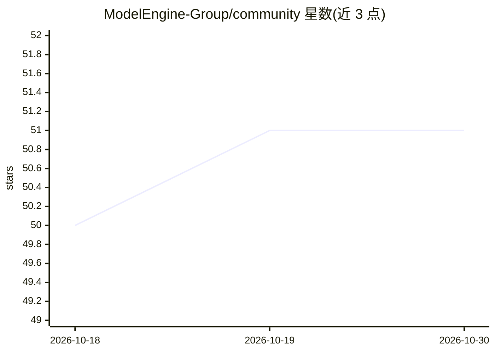

# ModelEngine-Group/community

⭐ 51 · Python · 推送 2026-07-09 · [GitHub](https://github.com/ModelEngine-Group/community) · [官网](https://modelengine-ai.net) · 组织维护 · 中文 README

**ModelEngine 项目群的社区管理与成员名录仓库**

存放 ModelEngine 项目群（含 fit-framework、app-platform、nexent、Flex:ai、Medical-Agents-hub 等子项目）的社区管理信息：说明社区例会每月举行、会议信息存放于 Discussions 板块，并以表格形式列出各子项目的 Maintainer 与 Committer 姓名及联系方式。README 未提供安装、运行或代码使用说明。

## 筛选速览

| 维度 | 判定 | 备注 |
|---|---|---|
| AI 角色 | `ai-ecosystem` | LLM/agent 周边工具 |
| 许可风险 | `none` | — |
| 部署形态 | `None` |  |
| 模型依赖 | — | README 未给出锁定关系 |
| 硬件要求 | — | 无带数字的原话,不猜 |
| 安装摩擦 | `low` | 无编译、无系统依赖或容器化 |
| 成熟度 | — | 结构信号不足 |

## 能力要点

- 记录社区例会安排（每月举行，信息在 Discussions 板块）
- 列出 5+ 个子项目的 Maintainer 与 Committer 名录

## 适用场景

- 查找 ModelEngine 各子项目的社区负责人与联系方式
- 了解社区例会组织方式

## 场景标签

`精选清单` · 领域:学习与行业

## 证据(README 行号)

> L5: ModelEngine 社区例会每月举行，相关会议信息全部存放在 `Discussions` 板块。
> L34: ### Flex：ai

## 星数曲线

2026-10-18 50 → 2026-10-30 51（+1）

---
*卡片 v1 · prompt 1.4 · 生成 2026-10-24 · 置信度 low · 依据 README sha `44ad3ef322b8` · [字段定义](../../DATASET.md)*
