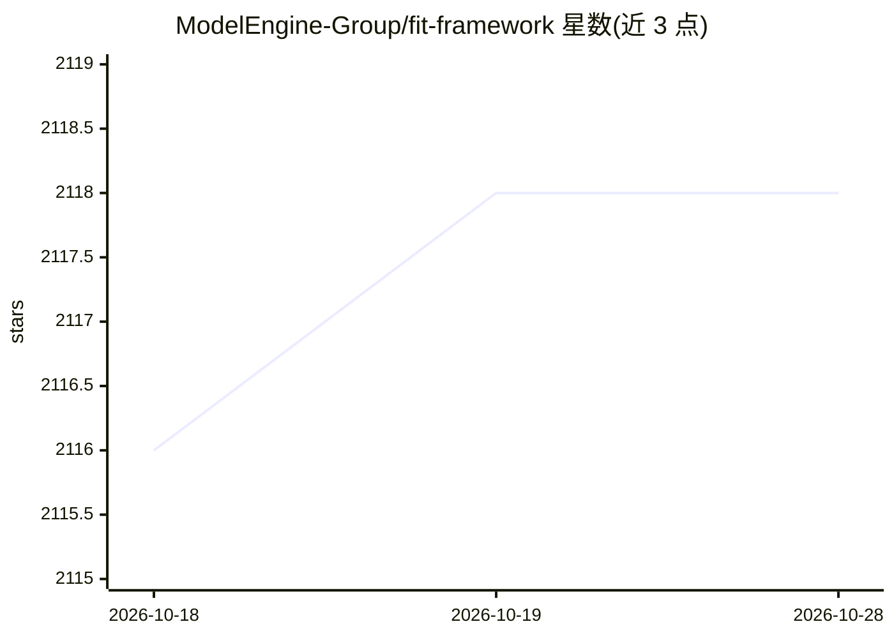

# ModelEngine-Group/fit-framework

⭐ 2,118 · Java · MIT · 推送 2026-03-13 · [GitHub](https://github.com/ModelEngine-Group/fit-framework) · [官网](https://modelengine-ai.net) · 组织维护 · 中文 README

**面向 Java 开发者的企业级 AI 开发框架**

Java 企业级 AI 开发框架，包含三个部分：FIT Core 多语言函数计算底座（Java/Python/C++），支持插件热插拔与单体/分布式一键切换的智能聚散部署；WaterFlow 流式编排引擎，提供图形化编排与声明式 API 双模驱动；FEL 表达式库，封装大模型、知识库与工具链，定位为 Java 生态的 LangChain 替代方案。支持原生与 Spring 双模运行。构建依赖 Maven 与 Java 17，附带基于 Docker 的 AI 编程沙箱工具（macOS）。限制：README 未展示 pip/npm 等包管理器安装方式，需源码构建。

## 筛选速览

| 维度 | 判定 | 备注 |
|---|---|---|
| AI 角色 | `ai-ecosystem` | LLM/agent 周边工具 |
| 许可风险 | `permissive` | MIT |
| 部署形态 | `None` |  |
| 模型依赖 | — | README 未给出锁定关系 |
| 硬件要求 | — | 无带数字的原话,不猜 |
| 安装摩擦 | `medium` | 含编译或系统依赖之一 |
| 成熟度 | — | 结构信号不足 |

## 能力要点

- 多语言函数计算底座（Java/Python/C++）支持插件热插拔
- WaterFlow 流式编排引擎，图形化编排与声明式 API 双模
- FEL 封装大模型/知识库/工具链，Java 生态的 LangChain 替代方案
- 单体与分布式应用不改代码一键切换的聚散部署

## 适用场景

- Java 团队在不切换技术栈的前提下构建大模型应用
- 用声明式 API 编排 AI 流程与跨系统长事务
- 需要插件热插拔与单体/分布式弹性切换的企业服务

## 场景标签

`Agent 框架` · 领域:Agent 开发

## 证据(README 行号)

> L5: **Java 企业级 AI 开发框架，提供多语言函数引擎（FIT）、流式编排引擎（WaterFlow）及 Java 生态的 LangChain 替代方案（FEL）。原生 /
> L27:  当 Python 阵营的 LangChain 重塑 AI 应用开发时，FEL 为 Java 开发者带来了更符合工程化实践的答案——基于标准化原语封装大模型、知识库与工具链，让

## 星数曲线

2026-10-18 2,116 → 2026-10-28 2,118（+2）

---
*卡片 v1 · prompt 1.4 · 生成 2026-10-21 · 置信度 high · 依据 README sha `ab50e0f0988f` · [字段定义](../../DATASET.md)*
