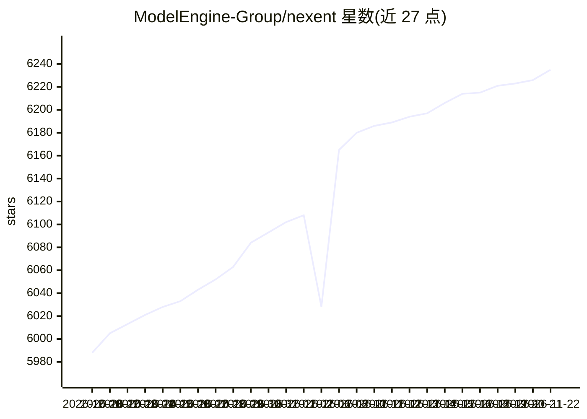

# ModelEngine-Group/nexent

⭐ 6,235 · Python · MIT · 推送 2026-11-21 · [GitHub](https://github.com/ModelEngine-Group/nexent) · [官网](http://modelengine-group.github.io/nexent/) · 组织维护 · 中文 README

**零代码平台：用自然语言自动生成生产级 AI Agent**

Nexent 是一个零代码 AI Agent 生成与编排平台，基于 Harness Engineering 原则：用户以纯自然语言描述需求即可生成可运行的 Agent，平台统一提供工具接入、技能加载、分层记忆（用户级 + 用户-Agent 级）与编排能力，内置 A2A 多 Agent 协作协议、MCP 工具生态、20+ 文档格式的个人知识库、引用溯源、多模态交互、版本管理与 Agent 市场，并提供多租户与 RBAC。部署方面提供 Docker（个人/小团队）与 Kubernetes/Helm（企业生产）两条路径，支持离线镜像包与交互式 TUI 配置。面向个人到企业用户的 Agent 构建场景。

## 筛选速览

| 维度 | 判定 | 备注 |
|---|---|---|
| AI 角色 | `ai-ecosystem` | LLM/agent 周边工具 |
| 许可风险 | `permissive` | MIT |
| 部署形态 | `self-host` | docker 或自建部署 |
| 模型依赖 | — | README 未给出锁定关系 |
| 硬件要求 | — | 无带数字的原话,不猜 |
| 安装摩擦 | `low` | 无编译、无系统依赖或容器化 |
| 成熟度 | — | 结构信号不足 |

## 能力要点

- 自然语言描述需求即刻生成可执行 Agent（零代码）
- A2A 协议多 Agent 协作与分层记忆机制
- 20+ 文档格式知识库、引用溯源与多模态交互
- Docker 与 Kubernetes/Helm 双部署路径，支持离线镜像包

## 适用场景

- 不写代码、用自然语言快速搭建业务 Agent
- 企业内私有化部署多租户 Agent 平台
- 构建多 Agent 协作的分布式工作流
- 接入个人知识库做可溯源的智能问答

## 场景标签

`多智能体` `RAG` `Agent 框架` · 领域:Agent 开发

## 证据(README 行号)

> L10: Nexent is a zero-code platform for auto-generating production-grade AI agents, built on **Harness Engineering** pri
> L83: |**⚙️ Multi-Model Integration**|OpenAI-compatible with any provider, full LLM/Embedding/VLM/STT/TTS coverage, suppo
> L89: |**🔧 MCP Tool Ecosystem**|Plug-and-play extension system with custom development and third-party MCP service suppor

## 星数曲线

2026-10-20 5,988 → 2026-11-22 6,235（+247）

---
*卡片 v1 · prompt 1.4 · 生成 2026-11-22 · 置信度 high · 依据 README sha `8467d18274a7` · [字段定义](../../DATASET.md)*
