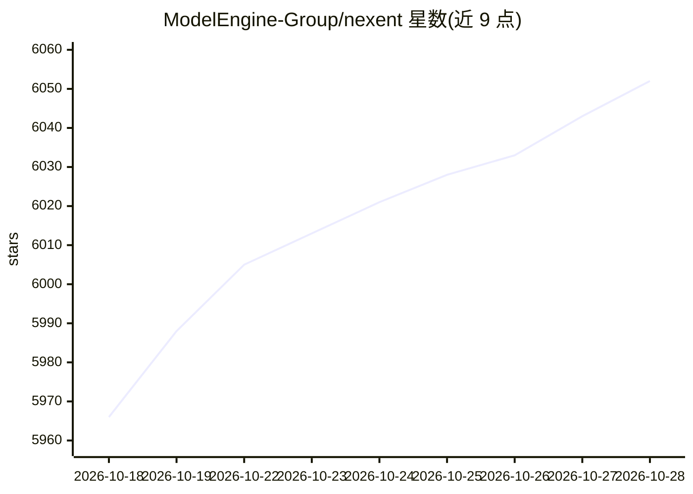

# ModelEngine-Group/nexent

⭐ 6,063 · Python · MIT · 推送 2026-10-28 · [GitHub](https://github.com/ModelEngine-Group/nexent) · [官网](http://modelengine-group.github.io/nexent/) · 组织维护 · 中文 README

**零代码生成生产级 AI Agent 的开源平台**

Nexent 是基于 Harness Engineering 理念的零代码 Agent 生成平台：用户以自然语言描述需求即可生成可执行 Agent，无需编排或拖拽。功能包括多模型接入（OpenAI 兼容、覆盖 LLM/Embedding/VLM/STT/TTS）、A2A 多 Agent 协作、双层记忆、渐进式 Skill 加载、支持 20+ 文档格式的知识库与溯源引用、MCP 工具生态、Agent 版本管理与市场、多租户 RBAC。提供 Docker 与 Kubernetes（Helm）两种部署方式及离线镜像包，MIT 许可。

## 筛选速览

| 维度 | 判定 | 备注 |
|---|---|---|
| AI 角色 | `ai-ecosystem` | LLM/agent 周边工具 |
| 许可风险 | `permissive` | MIT |
| 部署形态 | `self-host` | docker 或自建部署 |
| 模型依赖 | — | README 未给出锁定关系 |
| 硬件要求 | — | 无带数字的原话,不猜 |
| 安装摩擦 | `low` | 无编译、无系统依赖或容器化 |
| 成熟度 | — | 结构信号不足 |

## 能力要点

- 自然语言描述需求零代码生成可执行 Agent
- A2A 协议支持多 Agent 协作与分布式工作流
- 双层记忆（用户级+用户-Agent 级）与渐进式 Skill 加载
- 知识库支持 20+ 文档格式并带引用溯源

## 适用场景

- 不会编程的业务用户用自然语言搭建自己的 AI Agent
- 企业内部构建带知识库与权限隔离的智能体服务
- 团队通过 Agent 市场一键安装和复用社区 Agent

## 场景标签

`Agent 框架` `多智能体` `RAG` · 领域:Agent 开发

## 证据(README 行号)

> L10: Nexent is a zero-code platform for auto-generating production-grade AI agents, built on **Harness Engineering** pri
> L84: |**🤖 Zero-Code Agent Generation**|Describe requirements in natural language, generate executable agents instantly, 

## 星数曲线

2026-10-18 5,966 → 2026-10-28 6,052（+86）

---
*卡片 v1 · prompt 1.4 · 生成 2026-10-21 · 置信度 high · 依据 README sha `40964bff4030` · [字段定义](../../DATASET.md)*
