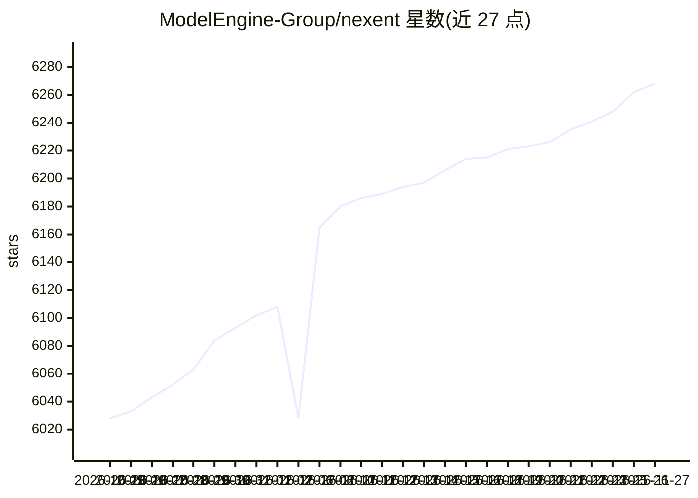

# ModelEngine-Group/nexent

⭐ 6,268 · Python · MIT · 推送 2026-11-26 · [GitHub](https://github.com/ModelEngine-Group/nexent) · [官网](http://modelengine-group.github.io/nexent/) · 组织维护

**零代码平台：用自然语言自动生成生产级 AI Agent**

Nexent 是一个零代码 AI Agent 生成平台，基于 Harness Engineering 原则，统一管理工具、技能、记忆与编排。用户以自然语言描述需求即可生成可执行 Agent，支持 OpenAI 兼容的多模型接入（LLM/Embedding/VLM/STT/TTS）、A2A 多智能体协作、两级分层记忆、20+ 文档格式的个人知识库、MCP 工具生态与 Agent 市场。部署提供 Docker（个人/小团队）与 Kubernetes（企业生产）两条路径，均支持离线镜像包与交互式 TUI 配置，采用 MIT 许可证。

## 筛选速览

| 维度 | 判定 | 备注 |
|---|---|---|
| AI 角色 | `ai-ecosystem` | LLM/agent 周边工具 |
| 许可风险 | `permissive` | MIT |
| 部署形态 | `self-host` | docker 或自建部署 |
| 模型依赖 | — | README 未给出锁定关系 |
| 硬件要求 | — | 无带数字的原话,不猜 |
| 安装摩擦 | `low` | 无编译、无系统依赖或容器化 |
| 成熟度 | — | 结构信号不足 |

## 能力要点

- 自然语言描述需求即时生成可执行 Agent，零代码
- 多模型接入：OpenAI 兼容任意提供商，覆盖 LLM/Embedding/VLM/STT/TTS
- A2A 协议多智能体协作与两级分层记忆机制
- 20+ 文档格式知识库、MCP 工具生态、Agent 市场与多租户 RBAC

## 适用场景

- 不写代码就为企业搭建生产级 AI Agent
- 在私有基础设施上部署多租户 Agent 平台
- 搭建个人知识库并实现引用可溯源的问答
- 编排多个 Agent 协作的分布式工作流

## 场景标签

`Agent 框架` `多智能体` `RAG` · 领域:Agent 开发

## 证据(README 行号)

> L10: Nexent is a zero-code platform for auto-generating production-grade AI agents, built on **Harness Engineering** pri
> L89: |**⚙️ Multi-Model Integration**|OpenAI-compatible with any provider, full LLM/Embedding/VLM/STT/TTS coverage, suppo
> L90: |**🤖 Zero-Code Agent Generation**|Describe requirements in natural language, generate executable agents instantly, 

## 星数曲线

2026-10-25 6,028 → 2026-11-27 6,268（+240）

---
*卡片 v1 · prompt 1.4 · 生成 2026-11-27 · 置信度 high · 依据 README sha `2be0213c1744` · [字段定义](../../DATASET.md)*
