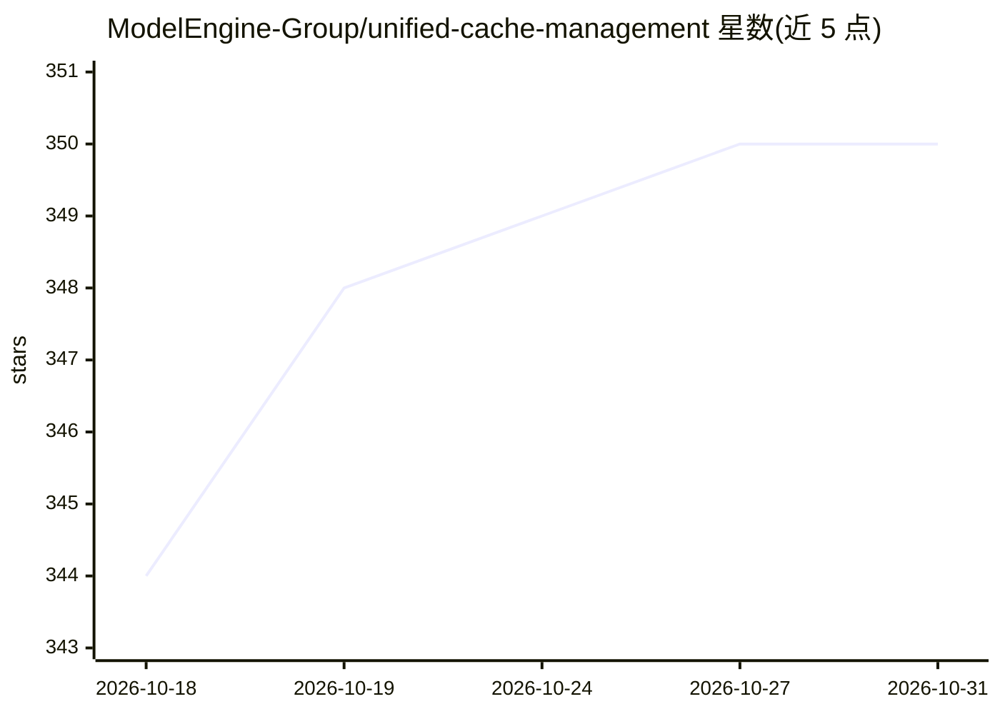

# ModelEngine-Group/unified-cache-management

⭐ 350 · C++ · MIT · 推送 2026-10-30 · [GitHub](https://github.com/ModelEngine-Group/unified-cache-management) · [官网](https://ucm.readthedocs.io/en/latest/) · 组织维护 · 中文 README

**LLM 推理的统一 KV Cache 管理层：跨引擎持久化复用缓存**

位于推理引擎与存储之间的统一 KV Cache 层，管理缓存复用、放置与迁移，使兼容请求与推理实例可复用已有计算，减少重复 Prefill 并缓解加速器显存压力。面向 Agent 工作流、多轮对话、多模态等同上下文重复访问的场景，通过可插拔接口让引擎适配器、缓存机制（含 KV Bridge、PD 迁移、稀疏注意力支持）与存储后端独立演进。具体安装命令、镜像标签与配置示例维护在文档中，README 未直接给出；功能可用性依赖所选引擎/模型/平台/后端组合。采用 MIT 附加条件许可。

## 筛选速览

| 维度 | 判定 | 备注 |
|---|---|---|
| AI 角色 | `ai-ecosystem` | LLM/agent 周边工具 |
| 许可风险 | `permissive` | MIT |
| 部署形态 | `None` |  |
| 模型依赖 | — | README 未给出锁定关系 |
| 硬件要求 | — | 无带数字的原话,不猜 |
| 安装摩擦 | `low` | 无编译、无系统依赖或容器化 |
| 成熟度 | — | 结构信号不足 |

## 能力要点

- 推理引擎与存储之间的统一 KV Cache 生命周期管理（复用/放置/迁移）
- 全局 KV Store 抽象：文件系统、内存池等可插拔后端
- 支持 PD 迁移、共享前缀、多模态上下文与稀疏注意力相关策略
- 引擎适配器、缓存机制、存储后端通过可插拔接口独立演进

## 适用场景

- 多轮对话与 Agent 工作流中复用 KV Cache 减少重复计算
- 通过外部存储扩展 KV Cache 容量，缓解显存压力
- 为不同推理引擎接入统一的缓存管理层

## 场景标签

`推理引擎` · 领域:训练与推理

## 证据(README 行号)

> L14: **Unified Cache Manager (UCM) is a unified KV Cache layer between inference engines and storage.** It manages cache
> L24: - **Unified Cache** manages the cache's usage lifecycle: what to reuse, where to retain it, and when to move it. Pr

## 星数曲线

2026-10-18 344 → 2026-10-31 350（+6）

---
*卡片 v1 · prompt 1.4 · 生成 2026-10-22 · 置信度 high · 依据 README sha `b822e4ea0a42` · [字段定义](../../DATASET.md)*
