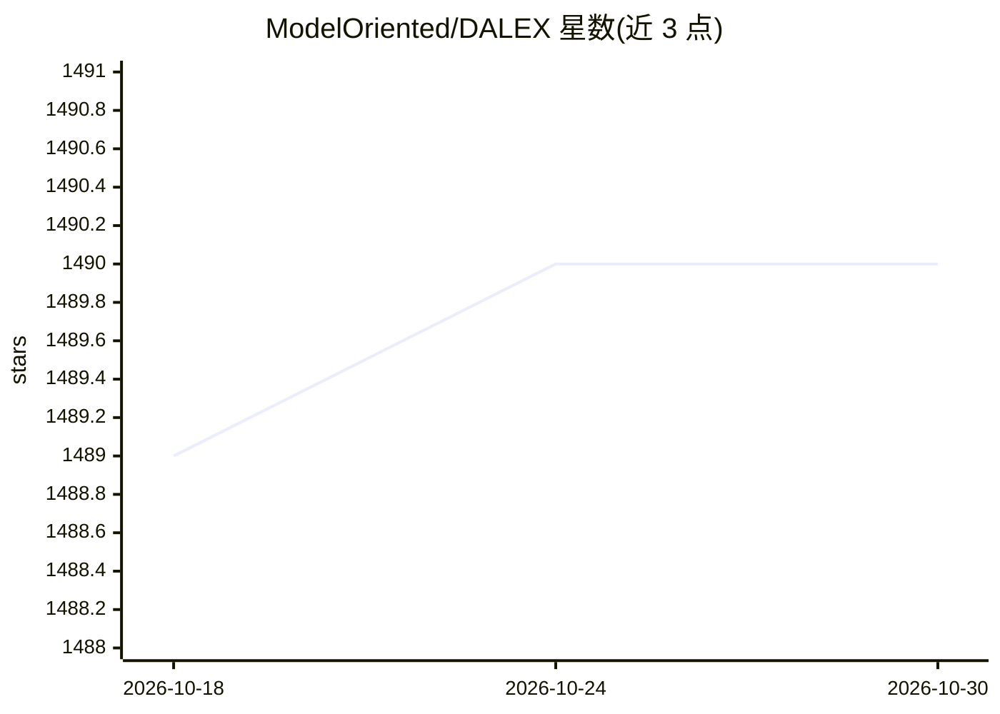

# ModelOriented/DALEX

⭐ 1,490 · Python · GPL-3.0 · 推送 2026-07-15 · [GitHub](https://github.com/ModelOriented/DALEX) · [官网](https://dalex.drwhy.ai) · 组织维护

**模型无关的机器学习模型解释与探索工具包（R/Python）**

DALEX 提供模型不可知的解释框架：核心函数 explain() 包装任意预测模型，随后可用一组局部与全局解释器（变量归因、残差、shap/lime 风格解释、what-if 分析等）探索和比较模型行为，并含 Fairness 公平性模块与 Arena 交互式仪表盘。同时提供 R（CRAN）与 Python（PyPI/conda-forge）两个版本，扩展包 DALEXtra 支持 scikit-learn、keras、H2O、xgboost、tidymodels、mlr3 等框架创建的模型。属于 DrWhy.AI 生态，附 JMLR 论文可供引用。

## 筛选速览

| 维度 | 判定 | 备注 |
|---|---|---|
| AI 角色 | `ai-ecosystem` | LLM/agent 周边工具 |
| 许可风险 | `viral` | GPL-3.0 |
| 部署形态 | `library` | 以包/库形式分发 |
| 模型依赖 | — | README 未给出锁定关系 |
| 硬件要求 | — | 无带数字的原话,不猜 |
| 安装摩擦 | `low` | 无编译、无系统依赖或容器化 |
| 成熟度 | — | 结构信号不足 |

## 能力要点

- explain() 包装任意预测模型，模型不可知的局部/全局解释器集合
- Fairness 公平性模块与 Arena 交互式模型探索仪表盘
- DALEXtra 扩展支持 scikit-learn/keras/H2O/xgboost/tidymodels/mlr3 等框架模型
- 同一工具包在 R 与 Python 双语言发布

## 适用场景

- 对已训练的黑箱模型做变量归因与预测解释
- 比较不同框架/语言训练的模型行为
- 对模型做公平性审查并验证预测依据

## 场景标签

 · 领域:可解释机器学习

## 证据(README 行号)

> L19: The `DALEX` package xrays any model and helps to explore and explain its behaviour, helps to understand how complex
> L23: If you work with `scikit-learn`, `keras`, `H2O`, `tidymodels`, `xgboost`, `mlr` or `mlr3` in R, you may be interest

## 星数曲线

2026-10-18 1,489 → 2026-10-30 1,490（+1）

---
*卡片 v1 · prompt 1.4 · 生成 2026-10-21 · 置信度 high · 依据 README sha `601e9408487f` · [字段定义](../../DATASET.md)*
