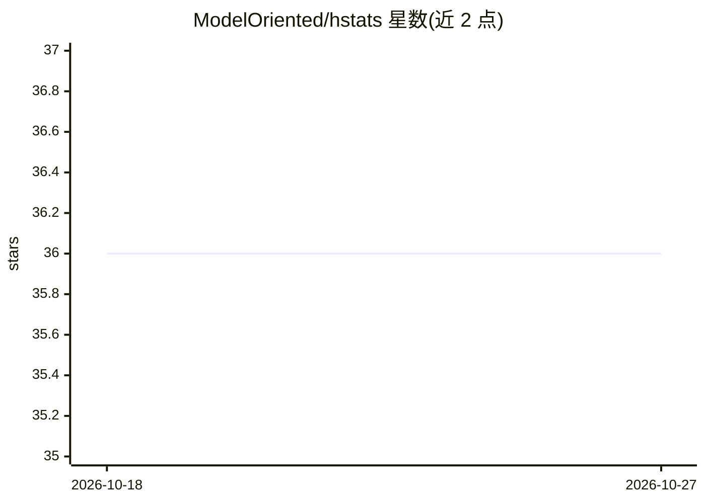

# ModelOriented/hstats

⭐ 36 · R · GPL-2.0 · 推送 2026-01-01 · [GitHub](https://github.com/ModelOriented/hstats) · [官网](https://modeloriented.github.io/hstats/) · 组织维护

**R 包：计算 Friedman H 统计量度量模型交互强度**

面向数据分析者的 R 统计包，实现 Friedman 与 Popescu 的 H 统计量族：整体、成对与三重交互强度，以及全局 H² 与实验性的部分依赖变量重要性。模型无关，支持多输出模型与案例权重，可直接应用于 DALEX explainer、mlr3、tidymodels、caret 等元学习器对象，并提供分层/二维部分依赖图与 ICE 图可视化。限制：基于部分依赖估计，复杂度 O(n²)，默认抽样 500 行，估计稳健性有限。经 CRAN 与 GitHub 安装。

## 筛选速览

| 维度 | 判定 | 备注 |
|---|---|---|
| AI 角色 | `ai-ecosystem` | LLM/agent 周边工具 |
| 许可风险 | `viral` | GPL-2.0 |
| 部署形态 | `None` |  |
| 模型依赖 | — | README 未给出锁定关系 |
| 硬件要求 | — | 无带数字的原话,不猜 |
| 安装摩擦 | `low` | 无编译、无系统依赖或容器化 |
| 成熟度 | — | 结构信号不足 |

## 能力要点

- 整体/成对/三重交互强度 H 统计量与全局 H²
- 模型无关，支持多输出模型与案例权重
- 兼容 DALEX、mlr3、tidymodels、caret 等，可自定义预测函数
- 提供分层 PDP、二维 PDP 与 ICE 图可视化及部分依赖变量重要性

## 适用场景

- 度量黑盒模型中特征交互强度并定位主要交互
- 用分层 PDP/ICE 图考察交互的具体形态
- 对多输出分类模型做交互与变量重要性分析

## 场景标签

 · 领域:机器学习可解释性/统计

## 证据(README 行号)

> L11: The first step in understanding interactions is to measure their strength. This is exactly what Friedman and Popesc
> L21: {hstats} offers these statistics comparably **fast** and for **any model**, even for multi-output models, or models
> L23: The core functions `hstats()`, `partial_dep()`, `ice()`, `perm_importance()`, and `average_loss()` can directly be 

## 星数曲线

2026-10-18 36 → 2026-10-27 36（+0）

---
*卡片 v1 · prompt 1.4 · 生成 2026-10-25 · 置信度 high · 依据 README sha `5843e3abb437` · [字段定义](../../DATASET.md)*
