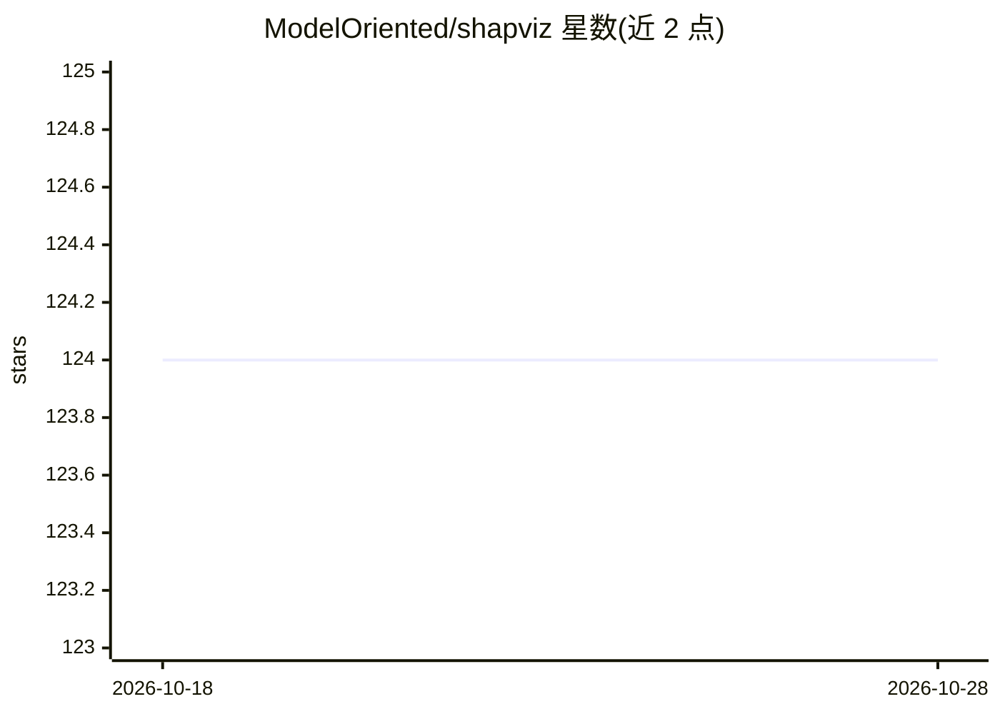

# ModelOriented/shapviz

⭐ 124 · R · GPL-2.0 · 推送 2026-08-31 · [GitHub](https://github.com/ModelOriented/shapviz) · [官网](https://modeloriented.github.io/shapviz/) · 组织维护

**R 包：把 SHAP 值可视化成多种解释图形**

R 语言的可解释性可视化包，围绕 'shapviz' 对象提供 SHAP 图形：重要性图（条形/蜂群）、依赖图与 2D 依赖图、交互图、瀑布图与力图。数据来源支持三类：可直接计算 SHAP 的模型（XGBoost、LightGBM、H2O）、SHAP 计算包（fastshap、kernelshap、treeshap、fastr、DALEX），或直接提供 SHAP 矩阵与特征值。用 {patchwork} 拼接多图并统一坐标尺度。通过 CRAN 或 GitHub 安装，面向使用 R 的建模与数据分析开发者。

## 筛选速览

| 维度 | 判定 | 备注 |
|---|---|---|
| AI 角色 | `ai-ecosystem` | LLM/agent 周边工具 |
| 许可风险 | `viral` | GPL-2.0 |
| 部署形态 | `None` |  |
| 模型依赖 | — | README 未给出锁定关系 |
| 硬件要求 | — | 无带数字的原话,不猜 |
| 安装摩擦 | `low` | 无编译、无系统依赖或容器化 |
| 成熟度 | — | 结构信号不足 |

## 能力要点

- sv_importance/sv_dependence/sv_interaction/sv_waterfall/sv_force 等系列 SHAP 图形
- 支持从 XGBoost、LightGBM、H2O 模型直接构建 shapviz 对象
- 兼容 fastshap、kernelshap、treeshap、fastr、DALEX 等 SHAP 计算包
- 用 {patchwork} 拼接多图并统一坐标/颜色尺度

## 适用场景

- 为梯度提升模型生成 SHAP 重要性图与蜂群图
- 用瀑布图/力图解释单条预测的分解
- 在多模型、多输出或子组分析中对比特征效应

## 场景标签

 · 领域:可解释 AI/机器学习可视化

## 证据(README 行号)

> L9: {shapviz} provides typical SHAP plots:
> L20: 2. SHAP crunchers like {fastshap}, {kernelshap}, {treeshap}, {fastr}, and {DALEX}.

## 星数曲线

2026-10-18 124 → 2026-10-28 124（+0）

---
*卡片 v1 · prompt 1.4 · 生成 2026-10-23 · 置信度 high · 依据 README sha `883b95b08782` · [字段定义](../../DATASET.md)*
