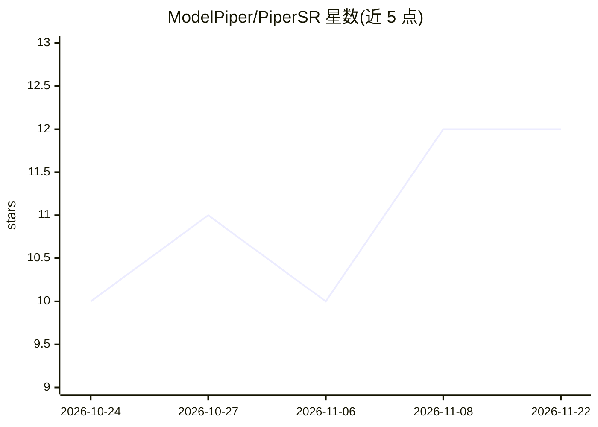

# ModelPiper/PiperSR

⭐ 12 · Python · AGPL-3.0 · 推送 2026-10-21 · [GitHub](https://github.com/ModelPiper/PiperSR) · [官网](https://modelpiper.com) · 个人维护

**面向 Apple Neural Engine 的 2x 实时图像超分模型**

PiperSR 是为 Apple Neural Engine 从头设计的单图像 2x 超分辨率模型：453K 参数、928 KB CoreML FP16 包，仅用 conv/silu/add/pixel_shuffle/clip 五种 ANE 原生算子，在 M2 Max 上实现 360p→720p 的 44.4 FPS 实时推理，全程不占用 GPU 与云端。通过 PyPI 包（权重内置）、CoreML 模型文件和 Hugging Face 分发，附带 benchmark.py 复现 PSNR 指标。限制：质量上 Set5 较 SPAN-S 低 0.5 dB；训练数据误含 Urban100 测试图，故不报告 Urban100 成绩；实时视频管线需配套的 ToolPiper Studio。

## 筛选速览

| 维度 | 判定 | 备注 |
|---|---|---|
| AI 角色 | `ai-native` | 本体是模型或模型工具 |
| 许可风险 | `viral` | AGPL-3.0 |
| 部署形态 | `library` | 以包/库形式分发 |
| 模型依赖 | — | README 未给出锁定关系 |
| 硬件要求 | — | 无带数字的原话,不猜 |
| 安装摩擦 | `medium` | 含编译或系统依赖之一 |
| 成熟度 | `idea` | |

## 能力要点

- 全部算子落在 Apple Neural Engine，GPU 占用 0%，无需云端
- 928 KB CoreML FP16 权重随 PyPI 包内置，无额外下载与 API key
- 360p→720p 在 M2 Max 上 44.4 FPS，双缓冲视频管线
- benchmark.py 可复现 README 中全部 PSNR 与 FPS 数据

## 适用场景

- 在 Mac/iPhone/iPad 上本地做图片 2x 放大
- Apple Silicon 上对 360p/480p 视频做实时超分
- GPU 被渲染占用时用 ANE 执行推理任务

## 场景标签

`图像视频处理` `推理引擎` · 领域:感知与多模态

## 证据(README 行号)

> L3: **First super-resolution model designed and optimized for Apple Neural Engine.**
> L220: - **Task:** Single-image 2x super-resolution
> L225: - **Compute:** Apple Neural Engine via `.cpuAndNeuralEngine`

## 星数曲线

2026-10-24 10 → 2026-11-22 12（+2）

---
*卡片 v1 · prompt 1.4 · 生成 2026-11-18 · 置信度 high · 依据 README sha `762e03cc6d69` · [字段定义](../../DATASET.md)*
