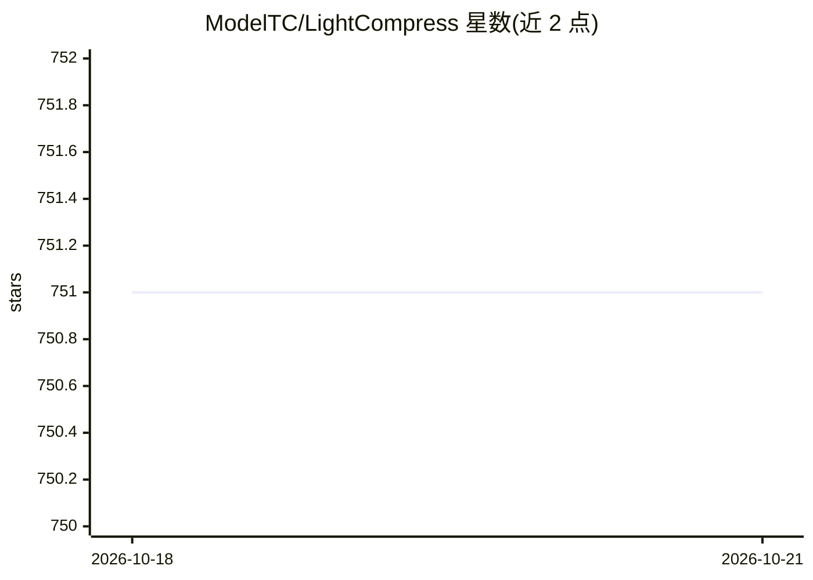

# ModelTC/LightCompress

⭐ 751 · Python · Apache-2.0 · 推送 2026-05-14 · [GitHub](https://github.com/ModelTC/LightCompress) · 组织维护 · 中文 README

**压缩 LLM/VLM/视频生成模型的工具包，含量化、剪枝与 token 缩减算法**

面向大模型部署的压缩工具包（原 LLMC），提供整数量化、浮点量化、混合精度量化、结构化/非结构化剪枝以及 VLM token 缩减等算法（AWQ、GPTQ、SmoothQuant、QuaRot、Wanda、ToMe 等），支持 LLaMA、Qwen、InternLM2、DeepSeek 系列 MOE、VLM 及 Wan2.1 视频生成模型。可导出真实量化 INT4/INT8/FP8 权重并对接 vLLM、SGLang、LightLLM、MLC-LLM、AutoAWQ 等推理后端。提供 Docker 镜像，推荐 Python 3.11。有 EMNLP 2024 与 AAAI 2026 论文。

## 筛选速览

| 维度 | 判定 | 备注 |
|---|---|---|
| AI 角色 | `ai-ecosystem` | LLM/agent 周边工具 |
| 许可风险 | `permissive` | Apache-2.0 |
| 部署形态 | `self-host` | docker 或自建部署 |
| 模型依赖 | local-ok | 支持本地模型 |
| 硬件要求 | — | 无带数字的原话,不猜 |
| 安装摩擦 | `low` | 无编译、无系统依赖或容器化 |
| 成熟度 | — | 结构信号不足 |

## 能力要点

- 覆盖量化、混合精度、剪枝、token 缩减的多类压缩算法
- 支持 DeepSeek-R1-671B 等 MOE 模型与 VLM、视频生成模型压缩
- 导出真实量化 INT4/INT8/FP8 权重并兼容 vLLM/SGLang 等多后端
- 提供量化最佳实践配置与下游评测支持（opencompass、lm-evaluation-harness）

## 适用场景

- 部署前将大模型量化为 INT4/INT8/FP8 以降低显存占用
- 为 vLLM/SGLang 等推理后端导出量化权重
- 对 VLM 做 token 缩减与量化以提升多模态推理效率

## 场景标签

`模型量化` · 领域:训练与推理

## 证据(README 行号)

> L20: **LightCompress** is an off-the-shell tool designed for compressing aigc models(LLM, VLM, Diffusion ...), leveragin
> L105: - 💥**Multi-backend Compatibility**: Seamlessly integrates with various backends for enhanced deployment flexibilit

## 星数曲线

2026-10-18 751 → 2026-10-21 751（+0）

---
*卡片 v1 · prompt 1.4 · 生成 2026-10-22 · 置信度 high · 依据 README sha `d130f212b862` · [字段定义](../../DATASET.md)*
