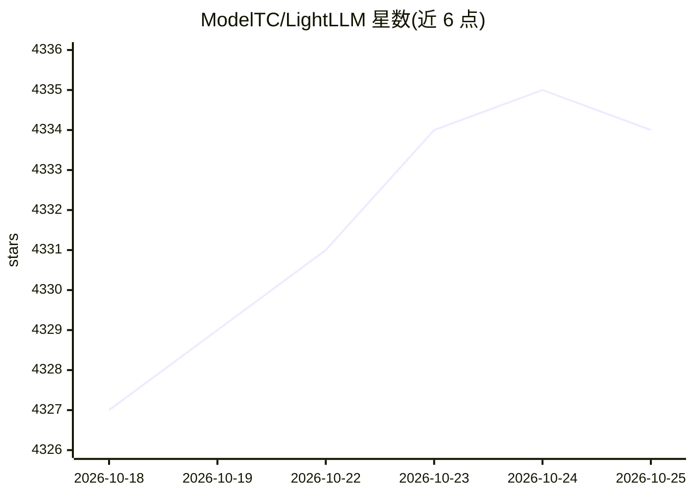

# ModelTC/LightLLM

⭐ 4,335 · Python · Apache-2.0 · 推送 2026-10-25 · [GitHub](https://github.com/ModelTC/LightLLM) · 组织维护 · 中文 README

**基于 Python 的 LLM 推理与服务框架**

LightLLM 是以 Python 实现的 LLM 推理与 serving 框架，设计为轻量、易扩展，并集成了 FasterTransformer、TGI、vLLM、FlashAttention 等开源实现的组件。提供 Docker 部署（README 含 Docker 徽章），支持 Prefix KV Cache 在 DP rank 间转移等特性，发布 v1.1.0。其组件被 vLLM、SGLang、Aphrodite 等项目引用，多篇论文（ACL2025 约束解码、ASPLOS'25 请求调度器）基于其研究。采用 Apache-2.0 许可。

## 筛选速览

| 维度 | 判定 | 备注 |
|---|---|---|
| AI 角色 | `ai-ecosystem` | LLM/agent 周边工具 |
| 许可风险 | `permissive` | Apache-2.0 |
| 部署形态 | `None` |  |
| 模型依赖 | — | README 未给出锁定关系 |
| 硬件要求 | — | 无带数字的原话,不猜 |
| 安装摩擦 | `low` | 无编译、无系统依赖或容器化 |
| 成熟度 | — | 结构信号不足 |

## 能力要点

- 纯 Python 实现与 token 级 KV Cache 管理
- Prefix KV Cache 在 DP rank 间转移（2025/11）
- 约束解码论文 Pre³ 获 ACL2025 杰出论文奖
- 组件被 vLLM、SGLang、Aphrodite 等项目引用

## 适用场景

- 部署 LLM 推理服务
- 作为 LLM serving 相关研究的二次开发基础
- 结构化生成场景下使用约束解码能力

## 场景标签

`推理引擎` · 领域:训练与推理

## 证据(README 行号)

> L10: LightLLM is a Python-based LLM (Large Language Model) inference and serving framework, notable for its lightweight 
> L53: Also, LightLLM's pure-python design and token-level KC Cache management make it easy to use as the basis for resear

## 星数曲线

2026-10-18 4,327 → 2026-10-25 4,334（+7）

---
*卡片 v1 · prompt 1.4 · 生成 2026-10-20 · 置信度 high · 依据 README sha `0fbc29189172` · [字段定义](../../DATASET.md)*
