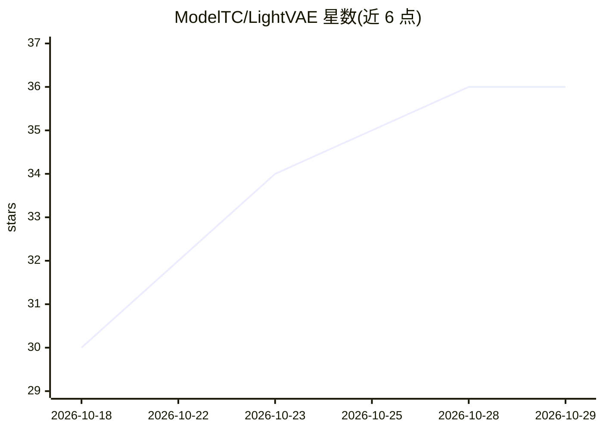

# ModelTC/LightVAE

⭐ 36 · Python · 推送 2026-10-14 · [GitHub](https://github.com/ModelTC/LightVAE) · [官网](https://arxiv.org/abs/2610.14726) · 组织维护

**视频生成模型的加速 VAE 解码器/编码器：适配 Wan 与 MiniMax-H3**

面向视频生成流水线的轻量视频自编码器：为 Wan2.1/Wan2.2 提供时间低秩压缩的 Pro 版与额外剪枝的 Lite 版解码器，为 MiniMax-H3 提供独立剪枝的编码器与解码器，压缩组件可与原版组件配对且保持原有 latent 接口。提供 Python 库（infer.py 重建、benchmark.py 解码器基准）与 H3 专用 ComfyUI 节点，权重托管于 HuggingFace。测试环境为 Python 3.11 / PyTorch 2.11 / CUDA 12.8。

## 筛选速览

| 维度 | 判定 | 备注 |
|---|---|---|
| AI 角色 | `ai-native` | 本体是模型或模型工具 |
| 许可风险 | `none` | — |
| 部署形态 | `library` | 以包/库形式分发 |
| 模型依赖 | — | README 未给出锁定关系 |
| 硬件要求 | — | 无带数字的原话,不猜 |
| 安装摩擦 | `medium` | 含编译或系统依赖之一 |
| 成熟度 | — | 结构信号不足 |

## 能力要点

- Wan2.1/2.2 的 Pro（时间低秩压缩）与 Lite（块剪枝）解码器
- MiniMax-H3 独立剪枝的编码器与解码器，无需原始 VAE 权重
- 压缩组件与原版组件兼容配对，保留原 latent 接口
- 提供 H3 ComfyUI 节点、重建与解码器基准脚本

## 适用场景

- 为 Wan/MiniMax-H3 视频生成流水线替换更快的 VAE 解码器
- 在 ComfyUI 中通过 Load H3 LightVAE 节点使用 Lite 组件
- 对比原版与压缩 VAE 的解码吞吐与重建质量（PSNR）

## 场景标签

`视频生成` · 领域:内容生成

## 证据(README 行号)

> L3: **Towards Compact and Efficient Video Autoencoders**
> L11: **LightVAE** accelerates pretrained video autoencoders while preserving their original latent interfaces.
> L14: - **Lite** — additional block pruning for Wan; independently pruned encoder and decoder for MiniMax-H3.

## 星数曲线

2026-10-18 30 → 2026-10-29 36（+6）

---
*卡片 v1 · prompt 1.4 · 生成 2026-10-25 · 置信度 high · 依据 README sha `a30165344e69` · [字段定义](../../DATASET.md)*
