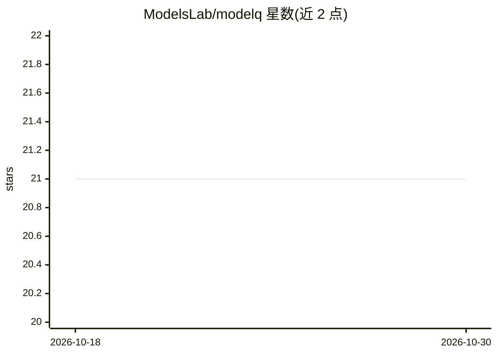

# ModelsLab/modelq

⭐ 21 · Python · MIT · 推送 2026-08-21 · [GitHub](https://github.com/ModelsLab/modelq) · 组织维护

**面向 ML 推理任务调度的 Python 任务队列库**

ModelQ 是由 ModelsLab 团队维护的 Python 库，用 Redis 与线程实现机器学习推理任务的后台调度与排队，README 自述定位为 ML 工作负载下 Celery 的更简单替代。功能包括任务重试、超时处理、流式结果、任务取消、进度跟踪、Pydantic 输入输出校验、中间件生命周期钩子，以及通过 FastAPI 把注册任务自动生成为 REST API 端点。提供 modelq CLI 用于启停 worker、查看队列状态与服务 API。运行需连接 Redis 实例。

## 筛选速览

| 维度 | 判定 | 备注 |
|---|---|---|
| AI 角色 | `ai-ecosystem` | LLM/agent 周边工具 |
| 许可风险 | `permissive` | MIT |
| 部署形态 | `library` | 以包/库形式分发 |
| 模型依赖 | — | README 未给出锁定关系 |
| 硬件要求 | — | 无带数字的原话,不猜 |
| 安装摩擦 | `low` | 无编译、无系统依赖或容器化 |
| 成熟度 | — | 结构信号不足 |

## 能力要点

- 装饰器注册任务，Redis 队列 + 线程并发执行
- 一条命令将注册任务自动生成为 FastAPI REST 端点
- 任务取消、进度跟踪、流式结果与中间件钩子
- worker 信息上报 CPU/RAM/GPU 系统资源

## 适用场景

- 把 ML 推理函数变成后台异步任务队列
- 无需写 Web 代码即可生成推理任务的 HTTP API
- 监控 worker 队列状态与系统资源利用

## 场景标签

`MLOps` · 领域:训练与推理

## 证据(README 行号)

> L20: ModelQ is a lightweight Python library for scheduling and queuing machine learning inference tasks. It's designed a
> L41: * 💃 Redis-based task queueing

## 星数曲线

2026-10-18 21 → 2026-10-30 21（+0）

---
*卡片 v1 · prompt 1.4 · 生成 2026-10-28 · 置信度 high · 依据 README sha `956804e337c9` · [字段定义](../../DATASET.md)*
