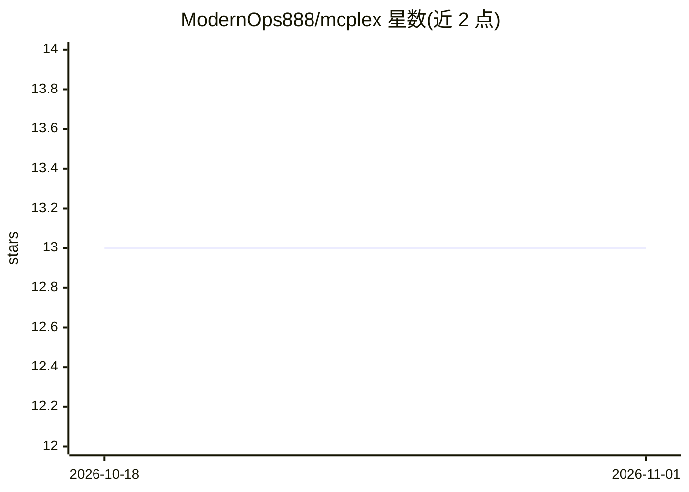

# ModernOps888/mcplex

⭐ 13 · Rust · MIT · 推送 2026-10-22 · [GitHub](https://github.com/ModernOps888/mcplex) · 个人维护

**MCP 智能网关：为 AI agent 做语义工具路由与安全管控**

单二进制 Rust 网关，部署在 AI agent 与多个 MCP 服务器之间，作为透明 MCP 代理复用 stdio 与 Streamable HTTP 两种传输。核心机制是 meta-tool 模式：tools/list 只返回 3 个网关元工具（约 200 tokens），agent 通过 mcplex_find_tools 按自然语言意图发现工具再调用，路由策略支持字符 n-gram 嵌入余弦相似度、TF-IDF 关键词或直通。每个 tools/call 经过 RBAC（基于 API key 服务端定角色）、工具黑名单、审计日志与响应缓存，提供 dashboard 与 systemd/launchd 服务化部署。限制：legacy 路由模式仅自定义客户端可用；RBAC 未配置 api_key 时默认拒绝全部调用。

## 筛选速览

| 维度 | 判定 | 备注 |
|---|---|---|
| AI 角色 | `ai-ecosystem` | LLM/agent 周边工具 |
| 许可风险 | `permissive` | MIT |
| 部署形态 | `None` |  |
| 模型依赖 | — | README 未给出锁定关系 |
| 硬件要求 | — | 无带数字的原话,不猜 |
| 安装摩擦 | `medium` | 含编译或系统依赖之一 |
| 成熟度 | — | 结构信号不足 |

## 能力要点

- meta-tool 模式将工具定义占用压缩至约 200 tokens（三种路由模式可切换）
- RBAC、每服务器工具黑名单、审计日志与响应缓存的统一安全管线
- stdio（持久子进程）与 Streamable HTTP 双传输复用
- 提供 Claude Code/Desktop 桥接脚本、VS Code/Cursor/Windsurf 接入配置与 dashboard

## 适用场景

- 多 MCP 服务器场景下削减 agent 上下文中工具定义的 token 占用
- 为 agent 的 MCP 调用统一加认证、RBAC 与审计
- 通过 dashboard 追踪调用成本与延迟并调试工具选择

## 场景标签

`模型网关` · 领域:Agent 开发

## 证据(README 行号)

> L29: MCPlex is a **single-binary Rust gateway** that sits between your AI agent and MCP servers:
> L154: MCPlex is a **transparent MCP proxy** — any MCP client that supports Streamable HTTP can connect to it. Your agent

## 星数曲线

2026-10-18 13 → 2026-11-01 13（+0）

---
*卡片 v1 · prompt 1.4 · 生成 2026-10-31 · 置信度 high · 依据 README sha `1e7ba397be95` · [字段定义](../../DATASET.md)*
