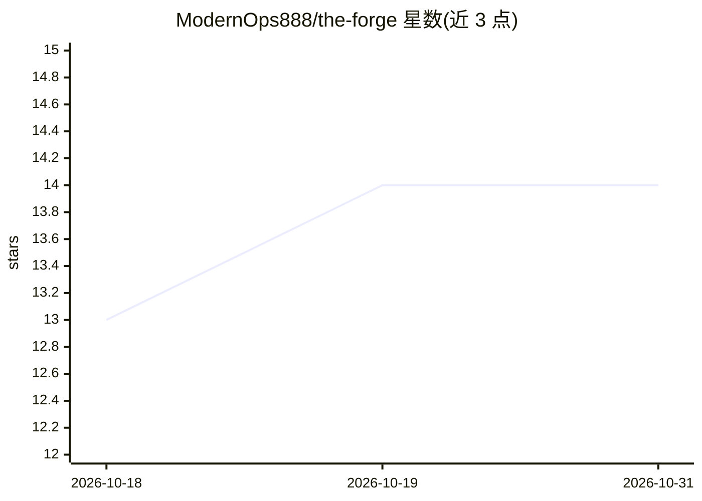

# ModernOps888/the-forge

⭐ 14 · Python · MIT · 推送 2026-10-23 · [GitHub](https://github.com/ModernOps888/the-forge) · 个人维护

**多 LLM 竞争+进化育种生成代码的平台，编译器做裁判**

多智能体代码进化平台：多个 LLM（支持 OpenRouter/Anthropic/OpenAI/Google/DeepSeek，可选 Ollama 本地推理）针对同一编程任务生成解决方案，经 Vitalis JIT 编译器的 7 道门（词法/解析/类型/Lint/能力/编译/执行）裁决，再以遗传算法（交叉、变异、6 种选择策略）按 6 维适应度（正确性 30%、性能 25% 等）迭代数百代。含 Agent Factory（18 种产物类型）、自改进引擎（带 AST 干跑、备份、质量下限等安全层）、SHA-256 溯源链、预算追踪与本地 Dashboard。面向在自己的机器上运行的开发者，明确声明为本地工具而非公共服务；需至少一个厂商 API key，Vitalis 编译器为可选（可回退到 Python）。

## 筛选速览

| 维度 | 判定 | 备注 |
|---|---|---|
| AI 角色 | `ai-ecosystem` | LLM/agent 周边工具 |
| 许可风险 | `permissive` | MIT |
| 部署形态 | `self-host` | docker 或自建部署 |
| 模型依赖 | local-ok | 支持本地模型 |
| 硬件要求 | — | 无带数字的原话,不猜 |
| 安装摩擦 | `low` | 无编译、无系统依赖或容器化 |
| 成熟度 | — | 结构信号不足 |

## 能力要点

- 多 LLM 竞赛 + JIT 编译器 7 道门裁决 + 遗传进化（交叉/变异/6 种选择算法）
- Agent Factory 生成 18 种产物类型（agent、MCP server、Rust 库、Lean 4 证明等）并自动布署
- 自改进引擎可修改自身源码，带 6 层安全机制（JSON 修复、AST 干跑、质量下限、自动备份等）
- SHA-256 哈希链溯源、PolicyEngine 治理、预算硬上限与按厂商成本追踪

## 适用场景

- 让多个模型竞争解决我的编程任务并进化出更优代码
- 批量生成并部署 agent、API、CLI、MCP server 等工程脚手架
- 追踪多厂商 LLM 调用成本并设置预算上限

## 场景标签

`多智能体` `代码生成` · 领域:Agent 开发

## 证据(README 行号)

> L12: **Multiple LLMs compete to solve coding challenges.
> L24: The Forge takes solutions from multiple LLMs, compiles them through a real JIT compiler (Vitalis), benchmarks them 
> L48: |**API Key**|Any vendor|At least one: OpenRouter, Anthropic, OpenAI, Google, or DeepSeek|

## 星数曲线

2026-10-18 13 → 2026-10-31 14（+1）

---
*卡片 v1 · prompt 1.4 · 生成 2026-10-31 · 置信度 mid · 依据 README sha `b1a8d4741215` · [字段定义](../../DATASET.md)*
