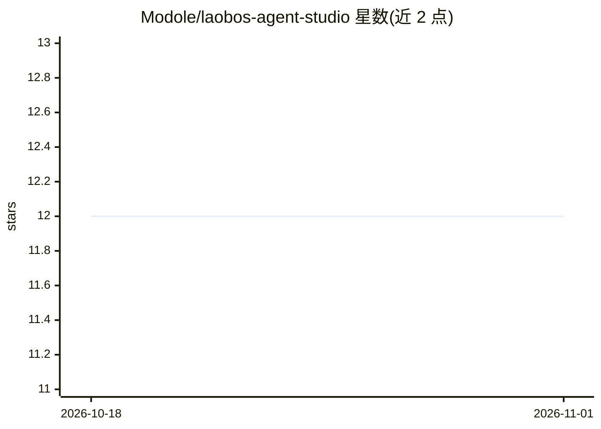

# Modole/laobos-agent-studio

⭐ 12 · JavaScript · NOASSERTION · 推送 2026-10-31 · [GitHub](https://github.com/Modole/laobos-agent-studio) · 个人维护 · 中文 README

**基于 DeepSeek Harness 的本地 Agent 桌面客户端，非商业许可**

以 Electron 桌面端承载 DeepSeek Harness（DSH）官方 Web UI 的 Agent 客户端：DSH 仅监听本机回环地址，Electron 以随机端口启动运行时并提供沙箱化渲染。功能覆盖五种 Agent 模式 preset、三档安全审批（含 Plan 模式强制只读）、Pi 数据迁移、SQLite+FTS 知识库、Skills/MCP 管理、插件市场，以及终端（tmux）、浏览器、SSH、Git 版本中心等桌面插件。提供 macOS ARM 与 Windows x64 原生安装包，由 GitHub Actions 构建，未配置签名证书。采用 PolyForm Noncommercial 1.0.0 许可，商业使用需书面授权。

## 筛选速览

| 维度 | 判定 | 备注 |
|---|---|---|
| AI 角色 | `ai-ecosystem` | LLM/agent 周边工具 |
| 许可风险 | `none` | NOASSERTION |
| 部署形态 | `library` | 以包/库形式分发 |
| 模型依赖 | locked-api |  |
| 硬件要求 | — | 无带数字的原话,不猜 |
| 安装摩擦 | `low` | 无编译、无系统依赖或容器化 |
| 成熟度 | — | 结构信号不足 |

## 能力要点

- Electron 桌面端直接启动 DSH 官方 Web UI，仅本机回环监听
- 五种 Agent 模式 preset 与三档安全审批权限预设
- 本地 SQLite + FTS 知识库、Skills/MCP 管理与内置插件市场
- macOS DMG 与 Windows NSIS 原生安装包，GitHub Actions 原生 Runner 构建

## 适用场景

- 在桌面端本地运行 DeepSeek Harness Agent 处理代码与工具任务
- 通过三列布局管理对话、知识库、Skills 与 MCP 连接
- 从旧 Pi 配置自动迁移 Provider、会话与知识库数据

## 场景标签

`编码 Agent` `AI 助手` · 领域:编码与开发

## 证据(README 行号)

> L6: 劳博士的 Agent 主引擎已经替换为 DeepSeek Harness（DSH）。开发服务与 Electron 桌面端都直接启动官方 DSH Web UI，不再经过 Pi Bridge；原 Vinext 界面和 Pi Bridge
> L17: DSH 只监听本机回环地址。Electron 使用随机端口启动运行时，渲染进程保持 `sandbox: true`、`nodeIntegration: false`，并拒绝网页权限请求。

## 星数曲线

2026-10-18 12 → 2026-11-01 12（+0）

---
*卡片 v1 · prompt 1.4 · 生成 2026-11-01 · 置信度 high · 依据 README sha `ae69c0c8fe8b` · [字段定义](../../DATASET.md)*
