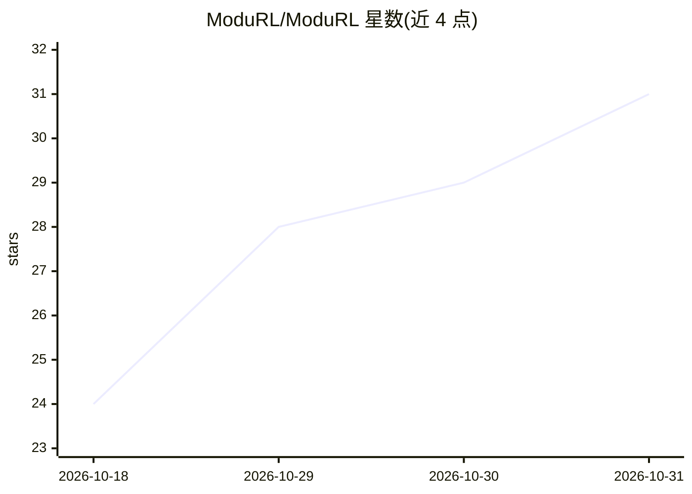

# ModuRL/ModuRL

⭐ 31 · Rust · MIT · 推送 2026-10-28 · [GitHub](https://github.com/ModuRL/ModuRL) · [官网](https://modurl.github.io/ModuRL/) · 组织维护

**面向 Rust 的深度强化学习框架，提供训练与环境集成**

以 Rust 编写的深度强化学习框架，基于 burn 张量后端，覆盖 PPO、A2C、SAC、DDPG、TD3、DQN、Double DQN 等算法，并提供 MLP 与 actor-critic 网络、分类/高斯/变换策略分布、rollout 与 replay 缓冲、参数调度及 TensorBoard 日志。环境侧集成 classic control、Box2D、MuJoCo v5 与 Atari（ALE）。训练决策保留在调用处，通过类型化 builder 组装各组件；张量形状、设备、网络与优化器配置均需显式指定。以 workspace 多 crate 组织，核心 crate 默认无依赖特性。README 声明项目处于早期开发阶段，公共 API 可能在版本间变化。

## 筛选速览

| 维度 | 判定 | 备注 |
|---|---|---|
| AI 角色 | `ai-ecosystem` | LLM/agent 周边工具 |
| 许可风险 | `permissive` | MIT |
| 部署形态 | `library` | 以包/库形式分发 |
| 模型依赖 | — | README 未给出锁定关系 |
| 硬件要求 | — | 无带数字的原话,不猜 |
| 安装摩擦 | `low` | 无编译、无系统依赖或容器化 |
| 成熟度 | `idea` | |

## 能力要点

- 7 种训练算法：PPO/A2C/SAC/DDPG/TD3/DQN/Double DQN
- 环境集成：classic control、Box2D、MuJoCo v5、Atari（ALE）
- 可替换组件契约：Gym/MultiGym 环境、独立或共享 actor-critic 网络、可配置 replay 设备
- Atari 吞吐量跨框架基准（与 Stable-Baselines3、CleanRL 对比）

## 适用场景

- 在 Rust 项目中训练 PPO/DQN 等算法
- 使用向量化环境与多线程包装器做批量训练
- 对比 Rust 与 Python 框架的 Atari 训练吞吐量

## 场景标签

`强化学习` · 领域:训练与推理

## 证据(README 行号)

> L8: `ModuRL` is a deep reinforcement learning framework for Rust.
> L52: - Training algorithms: PPO, A2C, SAC, DDPG, TD3, DQN, and Double DQN.

## 星数曲线

2026-10-18 24 → 2026-10-31 31（+7）

---
*卡片 v1 · prompt 1.4 · 生成 2026-10-27 · 置信度 high · 依据 README sha `dceea43d5204` · [字段定义](../../DATASET.md)*
