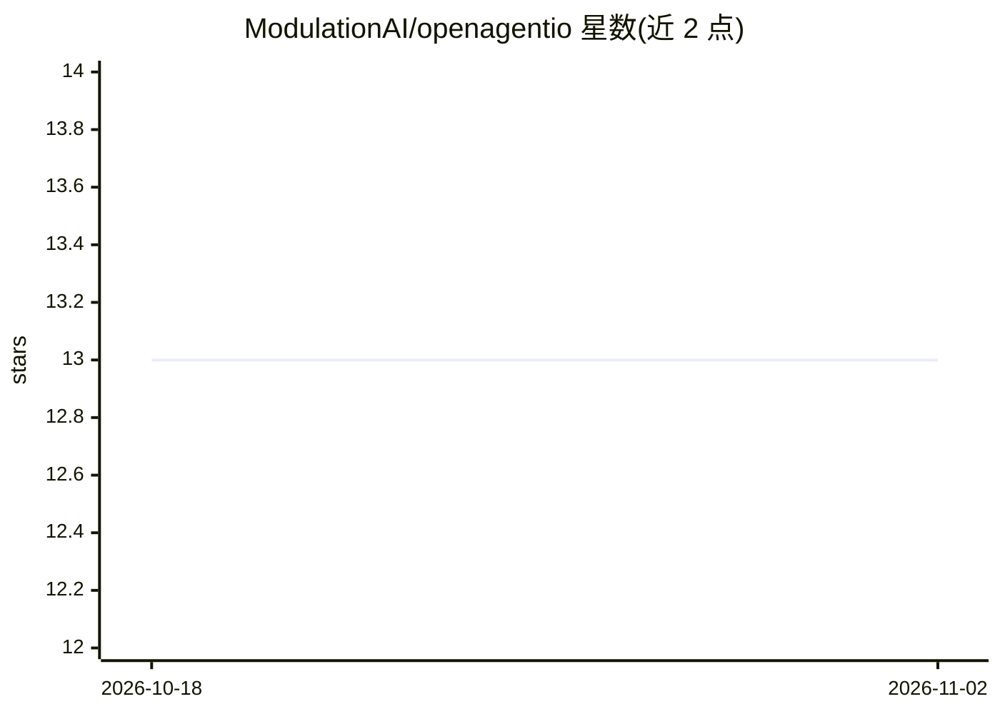

# ModulationAI/openagentio

⭐ 13 · Python · Apache-2.0 · 推送 2026-07-27 · [GitHub](https://github.com/ModulationAI/openagentio) · [官网](https://openagentio.dev) · 组织维护

**面向分布式 AI agent 的运行时通信总线与协议桥接层**

OpenAgentIO 是一个轻量级、可桥接的运行时总线（runtime bus），面向异构分布式 agent 系统。它将第三方协议与消息网络（MCP 服务器、Matrix 房间、HTTP/SSE 流式端点）映射到统一的总线模型，通过 Invoke、StreamInvoke、Publish/Subscribe 流转实现跨进程、跨语言（Go/Python/TypeScript SDK）的 agent 协作，并携带会话传播与 OpenTelemetry 追踪上下文。它不定义 agent 逻辑，也不替代 A2A 等标准，而是充当其下方的通信与可观测性基座。当前处于 Developer Preview（v0.3-alpha）阶段，安装细节指向外部 SDK Examples 仓库。

## 筛选速览

| 维度 | 判定 | 备注 |
|---|---|---|
| AI 角色 | `ai-ecosystem` | LLM/agent 周边工具 |
| 许可风险 | `permissive` | Apache-2.0 |
| 部署形态 | `None` |  |
| 模型依赖 | — | README 未给出锁定关系 |
| 硬件要求 | — | 无带数字的原话,不猜 |
| 安装摩擦 | `low` | 无编译、无系统依赖或容器化 |
| 成熟度 | `idea` | |

## 能力要点

- 将 MCP 服务器、Matrix 房间、HTTP/SSE 端点桥接为统一总线模型
- Invoke / StreamInvoke / Publish/Subscribe 三类消息流
- 会话传播与 OpenTelemetry 追踪上下文跨运行时传递
- Go / Python / TypeScript 多语言 SDK

## 适用场景

- 让分布在不同进程和语言的多个 agent 协同工作
- 把 MCP 工具、Matrix 消息、SSE 流式端点接入统一通信层
- 为多 agent 系统提供请求-回复、流式、发布订阅等通信模式

## 场景标签

`多智能体` · 领域:Agent 开发

## 证据(README 行号)

> L25: OpenAgentIO is a lightweight, bridgeable runtime bus and bridge layer for heterogeneous agent systems.
> L27: It maps third-party protocols, tools, and message networks (such as MCP servers, Matrix rooms, and HTTP/SSE streami
> L40: Yet, most agent frameworks focus on prompting, single-runtime orchestration, or local tool execution. OpenAgentIO s

## 星数曲线

2026-10-18 13 → 2026-11-02 13（+0）

---
*卡片 v1 · prompt 1.4 · 生成 2026-10-31 · 置信度 high · 依据 README sha `d5241421616b` · [字段定义](../../DATASET.md)*
