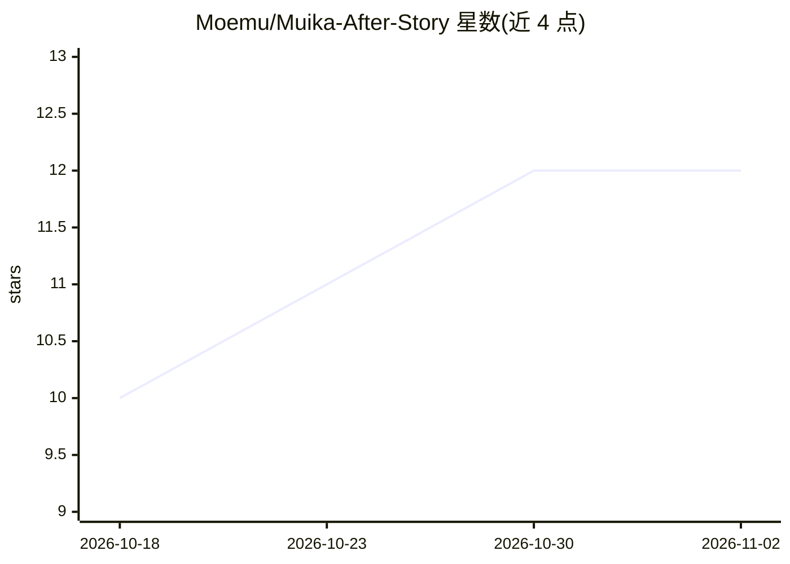

# Moemu/Muika-After-Story

⭐ 12 · Python · BSD-3-Clause · 推送 2026-10-29 · [GitHub](https://github.com/Moemu/Muika-After-Story) · [官网](https://mas.snowy.moe) · 组织维护 · 中文 README

**基于情感状态机与事件循环的拟角色 LLM 聊天机器人框架**

以 DDLC 角色 Monika 为原型的 LLM Chatbot 企划与框架：核心是事件循环与状态机驱动的交互逻辑，配有多层记忆（原始经历、自省日记、事实账本、持续情绪）与自动上下文压缩。支持通过系统 API 调用实现'打破第四面墙'能力（读写文件、截屏），可从话题配置或 RSS 主动发起对话。基于 NoneBot2 等适配器接入社交平台，Core 与 Bot 进程分离，支持多实例部署、插件热重载与 OpenAI/Ollama 等多模型 SDK。安装步骤见外部文档站。

## 筛选速览

| 维度 | 判定 | 备注 |
|---|---|---|
| AI 角色 | `ai-native` | 本体是模型或模型工具 |
| 许可风险 | `permissive` | BSD-3-Clause |
| 部署形态 | `library` | 以包/库形式分发 |
| 模型依赖 | local-ok | 支持本地模型 |
| 硬件要求 | — | 无带数字的原话,不猜 |
| 安装摩擦 | `low` | 无编译、无系统依赖或容器化 |
| 成熟度 | — | 结构信号不足 |

## 能力要点

- 事件循环系统与状态机驱动的交互逻辑
- 原始经历/日记/事实账本/持续情绪的多层记忆与上下文压缩
- 第四面墙 Agent：读写硬盘文件、截取屏幕
- 多模型 SDK（OpenAI、Ollama 等），配置热重载与多实例部署

## 适用场景

- 部署一个有持续记忆与情绪的拟角色聊天机器人
- 让 bot 主动从话题源或 RSS 新闻发起对话
- 通过 NoneBot2/AstrBot 适配器接入社交平台

## 场景标签

`聊天机器人` · 领域:对话与助手

## 证据(README 行号)

> L24: `Muika-After-Story`是一个全新的 LLM Chatbot 企划，正如企划原型角色Monika(Doki Doki Literature Club)#)一样，本企划的主角 `Muika` 同样具备打破第四面墙和“自
> L35: 基于上述见解，本框架为 LLM 提供了与系统 API 交互的能力，并通过 Nonebot2 框架与主流社交平台进行交互。
> L49: - [X] 多模型 SDK 支持: 如OpenAI 和 Ollama ，可加载市面上大多数的模型服务或本地模型，支持多模态（图片识别）。

## 星数曲线

2026-10-18 10 → 2026-11-02 12（+2）

---
*卡片 v1 · prompt 1.4 · 生成 2026-11-02 · 置信度 high · 依据 README sha `abb3611de1d8` · [字段定义](../../DATASET.md)*
