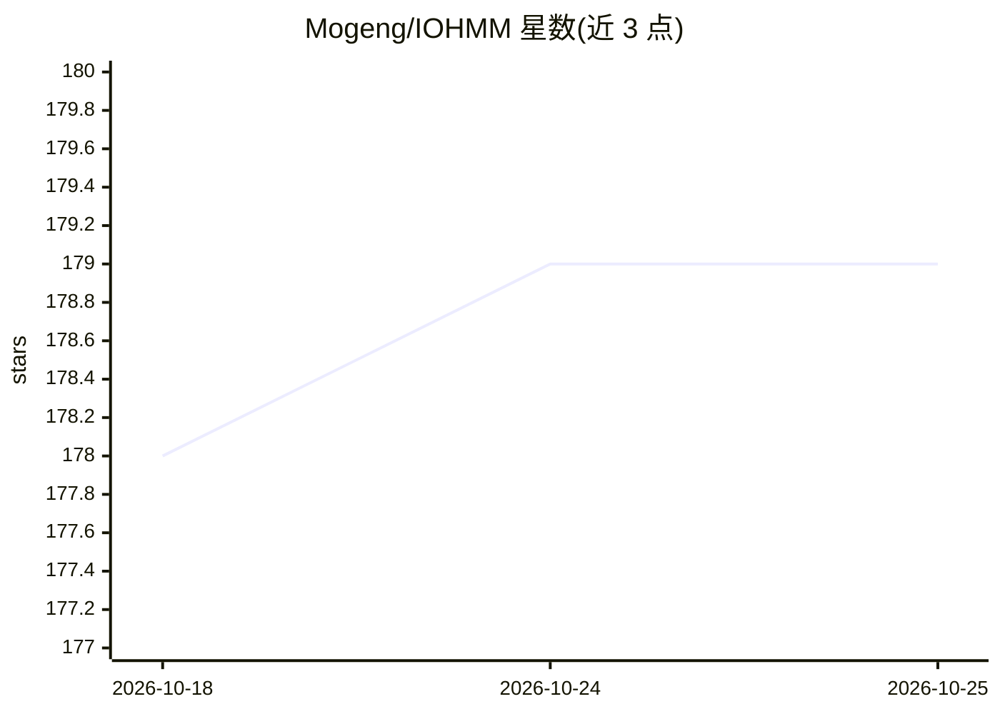

# Mogeng/IOHMM

⭐ 179 · Python · BSD-3-Clause · 推送 2026-05-23 · [GitHub](https://github.com/Mogeng/IOHMM) · 个人维护

**Python 的输入-输出隐马尔可夫模型（IOHMM）实现包**

Python 包，实现输入-输出隐马尔可夫模型：在标准 HMM 基础上允许初始、转移与发射概率依赖不同协变量输入。支持无监督（EM 算法）、半监督与监督三种训练方式。序列以 pandas DataFrame 表示，协变量通过列名指定；前向-后向算法全程向量并在对数层面计算，模型可通过 JSON 序列化保存/加载，亦可由 JSON 配置文件构建。线性模型部分封装 statsmodels 与 scikit-learn API，支持样本频率权重、正则化及部分模型的标准误估计。附 Jupyter Notebook 示例。

## 筛选速览

| 维度 | 判定 | 备注 |
|---|---|---|
| AI 角色 | `ai-native` | 本体是模型或模型工具 |
| 许可风险 | `permissive` | BSD-3-Clause |
| 部署形态 | `library` | 以包/库形式分发 |
| 模型依赖 | — | README 未给出锁定关系 |
| 硬件要求 | — | 无带数字的原话,不猜 |
| 安装摩擦 | `low` | 无编译、无系统依赖或容器化 |
| 成熟度 | — | 结构信号不足 |

## 能力要点

- 无监督/半监督/监督三种 IOHMM 训练模式
- 前向-后向算法全向量化和对数层面计算，适应长序列
- 模型与线性模型的 JSON 序列化保存/加载，支持配置文件建模
- 封装 statsmodels 与 scikit-learn 线性/广义线性模型接口

## 适用场景

- 对带协变量的时序数据做序列标注或隐状态估计
- 仅有部分隐状态标签时用半监督方式训练 HMM
- 用配置文件预定义模型结构并部署到应用中

## 场景标签

 · 领域:机器学习/统计建模

## 证据(README 行号)

> L7: IOHMM extends standard HMM by allowing (a) initial, (b) transition and (c) emission probabilities to depend on vario
> L39:  - UnSupervised IOHMM when you have no ground truth hidden states at any timestamp. Expectation-Maximization (EM) a

## 星数曲线

2026-10-18 178 → 2026-10-25 179（+1）

---
*卡片 v1 · prompt 1.4 · 生成 2026-10-22 · 置信度 high · 依据 README sha `73fa203dde7c` · [字段定义](../../DATASET.md)*
