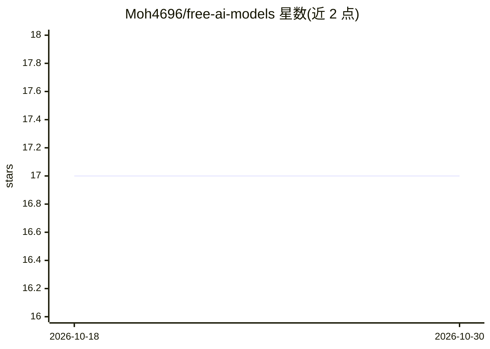

# Moh4696/free-ai-models

⭐ 17 · MIT · 推送 2026-06-19 · [GitHub](https://github.com/Moh4696/free-ai-models) · 个人维护

**免费访问主流 AI 模型的 10 种方法指南（教程清单）**

一篇教程型清单：整理 10 种免费使用 GPT、Claude、Llama、DeepSeek 等模型的方法，包括 GitHub Models、学生计划、NVIDIA NIM、OpenRouter、试用额度、Groq、Ollama 本地运行、Hugging Face、OpenAI Codex for OSS 计划以及将 Claude Code 指向免费后端。每种方法给出注册/取 key/调用的分步说明与 OpenAI 兼容端点示例代码，并逐项标注限制（请求配额、是否需信用卡/手机验证）。信息标注截至 2026 年 6 月，README 声明与各提供商无隶属关系。

## 筛选速览

| 维度 | 判定 | 备注 |
|---|---|---|
| AI 角色 | `ai-knowledge` | 知识聚合/清单类 |
| 许可风险 | `permissive` | MIT |
| 部署形态 | `library` | 以包/库形式分发 |
| 模型依赖 | — | README 未给出锁定关系 |
| 硬件要求 | — | 无带数字的原话,不猜 |
| 安装摩擦 | `low` | 无编译、无系统依赖或容器化 |
| 成熟度 | — | 结构信号不足 |

## 能力要点

- 覆盖 10 种免费访问渠道，每条附分步说明
- 每条附 'honest catch' 标注限制与前提
- 提供快速对比表（前沿模型/信用卡/免费额度）
- 提供按需求场景的选型建议（学生/隐私/速度等）

## 适用场景

- 不付费试前沿 OpenAI 或开源模型
- 学生身份获取工具折扣与免费年度权益
- 本地离线跑开源模型或按需选择免费 API 后端

## 场景标签

`教程课程` · 领域:学习与行业

## 证据(README 行号)

> L3: A practical, no-fluff guide to running frontier and open-weight AI models **without a subscription and without a cre
> L9: 1. GitHub Models — frontier OpenAI models, no credit card
> L22: ## 1️⃣ GitHub Models

## 星数曲线

2026-10-18 17 → 2026-10-30 17（+0）

---
*卡片 v1 · prompt 1.4 · 生成 2026-10-30 · 置信度 mid · 依据 README sha `398476da78f6` · [字段定义](../../DATASET.md)*
